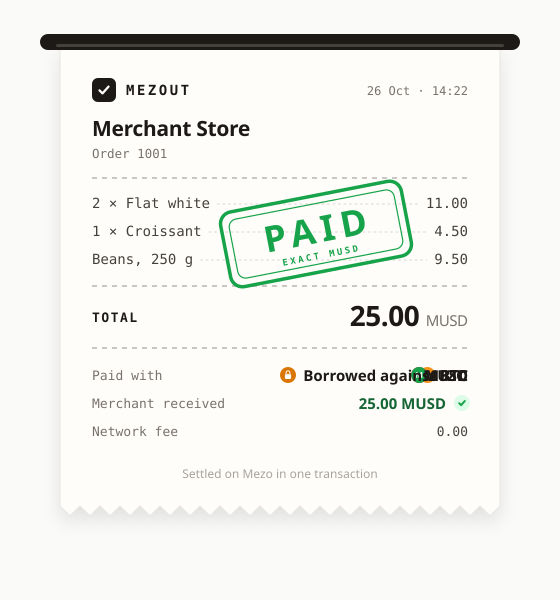
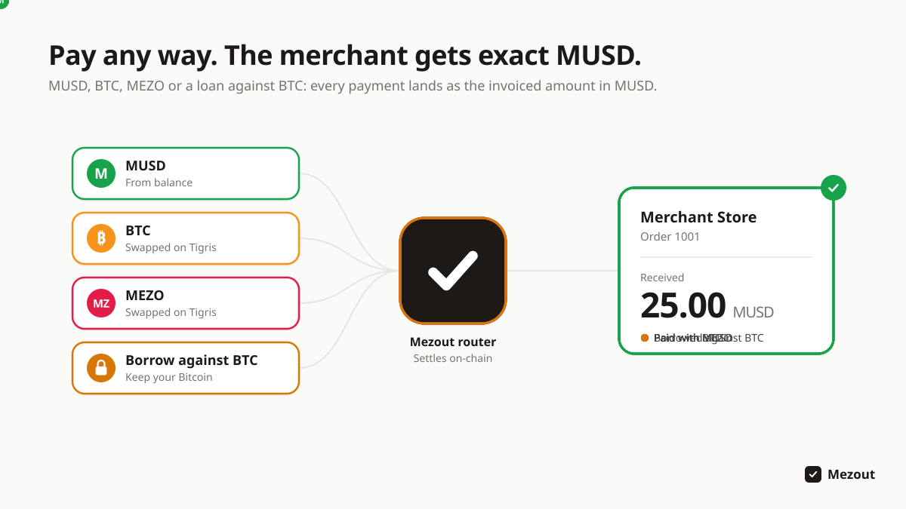

# Mezout

**Pay with Bitcoin. Get paid in MUSD.**

Mezout is checkout for Mezo. Customers pay with MUSD, BTC or MEZO, or borrow MUSD against their Bitcoin so they never have to sell it. Merchants are paid in stable MUSD, with the platform fee shown before they share a link. Merchants sign up with a passkey instead of a wallet, customers with EVM wallets pay no gas, and Mezout plugs into a store through payment links, a REST API, WooCommerce, Shopify or an embedded checkout.

Built for the Mezo Buildathon (Access & Distribution). Live on Mezo testnet.

[**Live app**](https://usemezout.vercel.app) · [**API reference**](https://usemezout.vercel.app/docs) · [**How it works**](docs/ARCHITECTURE.md) · [**Contracts on Sourcify**](https://repo.sourcify.dev/31611/0x7151473F1300c2529A2eEFaA517684e974A9b3E6)

<p align="center"></p>

## At a glance

| | |
| --- | --- |
| **4 ways to pay** | MUSD, BTC, MEZO, or MUSD borrowed against BTC inside the payment |
| **Clear settlement** | The router receives exactly the invoiced MUSD in one transaction or the payment reverts; the signed platform fee is deducted from the merchant's payout |
| **No gas** | A relayer submits EVM-wallet payments and every passkey withdrawal |
| **No wallet for merchants** | A passkey (Face ID, Touch ID, Windows Hello) controls an ERC-4337 payout account |
| **No custody, no admin keys** | Funds go from customer to merchant. The router has no owner, pause switch or upgrade path |
| **Live proof** | Every payment path has been paid on Mezo testnet ([transactions below](#live-on-mezo-testnet)) |

## The problem

Bitcoin holders don't want to sell their BTC to spend it. Merchants won't install a wallet, store a seed phrase or buy gas to get paid. Most crypto checkouts fail one side: the customer has to swap first, or the merchant ends up holding a volatile asset and managing keys. Mezout serves both in a single payment, and every checkout is new demand for MUSD and Mezo borrowing.

## What it does



- **Customers pay any way.** The hosted checkout reads the customer's wallet (EVM, or Bitcoin wallets such as Xverse, Unisat and OKX through Mezo Passport) and shows only the options that will succeed. BTC and MEZO are swapped on Tigris at a live price with a signed 1% cap.
- **Spend Bitcoin without selling it.** A customer with a Mezo loan can borrow the MUSD inside the payment. The router reverts the whole payment if the loan would end below 160% collateral, well above Mezo's 110% liquidation threshold.
- **Gasless.** EVM-wallet customers sign; Mezout's relayer submits and pays the gas. Bitcoin-wallet accounts pay a small fee themselves for now.
- **Merchants without a wallet.** A passkey creates a `MezoutAccount` (OpenZeppelin ERC-4337 with a WebAuthn signer) that receives payments before it is even deployed. Withdrawals are confirmed with the passkey and gasless. Merchants with a Mezo wallet can be paid straight into it instead.
- **Merchant dashboard.** Overview (balance, recent sales, payment links with QR codes), Payments (gross, fee and net per payment, CSV export, refunds), Developers (API keys, webhooks with test events and a delivery log, embedded checkout sites) and Account (business name, payout address, withdrawals).
- **Integrations.** A [REST API](docs/API.md) with idempotency keys and rate limits; signed webhooks (`invoice.paid`, `invoice.expired`, `refund.completed`, `refund.canceled`) retried for 24 hours, with [a dependency-free receiver](examples/webhook-receiver); the [WooCommerce plugin](plugins/woocommerce); the [Shopify app](plugins/shopify); and an embedded checkout (`/mezout.js` or [`@mezout/embed-react`](packages/embed-react)).
- **Agent payments.** A [Mezout MCP server](packages/mcp) (set up with `npx -y @mezout/mcp init`; [guide](https://usemezout.vercel.app/docs#ai-agents)) and an [agent skill](skills/mezout) (`npx skills add Evangel90/Mezout --skill mezout -g`) let AI agents create, check, refund and pay invoices within spending caps, and [`@mezout/paywall`](packages/paywall) charges per API request over HTTP 402 in the x402 v2 format, confirmed with `POST /v1/verify`.

Diagrams of every payment path, passkey withdrawals and the invoice lifecycle are in [`docs/ARCHITECTURE.md`](docs/ARCHITECTURE.md).

## Architecture

The **contracts** enforce every money rule. The **app** signs invoices, relays payments and runs the merchant platform, but can only submit transactions that customers and merchants have signed. **Integrations** connect stores.

| Component | Code | What it does |
| --- | --- | --- |
| `MezoutRouter` | [`contracts/src/MezoutRouter.sol`](contracts/src/MezoutRouter.sol) | Verifies the signed invoice and payer signature, takes payment by one of four methods, pays the merchant, emits `Paid`. Holds nothing between calls |
| `MezoutAccount` and factory | [`contracts/src/account`](contracts/src/account) | ERC-4337 account owned by a passkey, at a CREATE2 address from its public key |
| SDK | [`packages/sdk`](packages/sdk) | EIP-712 typed data, payment links, chain config, ABIs, trove and borrow-limit reads |
| Hosted checkout | [`apps/web/src/components/Checkout.tsx`](apps/web/src/components/Checkout.tsx) | Reads balances, live quotes and the customer's trove; offers only options that will succeed |
| Relayer | [`apps/web/src/app/api/relay/route.ts`](apps/web/src/app/api/relay/route.ts) | Simulates, then submits payments and pays the gas. Only calls Mezout's routers |
| Indexer and webhooks | [`apps/web/src/lib/server`](apps/web/src/lib/server) | `Paid` events are the only way an invoice becomes paid; signed webhooks with retries and a delivery log |
| Merchant API | [`apps/web/src/app/v1`](apps/web/src/app/v1) | Invoices, refunds and webhook endpoints |
| Store plugins | [`plugins/woocommerce`](plugins/woocommerce), [`plugins/shopify`](plugins/shopify) | Create an invoice per order and mark it paid from verified webhooks |

## Safety guarantees

| Guarantee | How it is enforced |
| --- | --- |
| Settlement is exact and disclosed | The router must receive the full signed `amount`; it sends `amount - fee` to the merchant and the signed fee to its recipient in the same transaction, or reverts |
| One invoice, one payment | `paid[orderId]` is set before any transfer. Invoices are EIP-712 signed by Mezout's invoice signer and expire |
| A copied signature can't pay anything else | Relayed payments need the payer's own `Payment` or `SwapPayment` signature naming that invoice |
| No push toward liquidation | After a borrow, `getCurrentICR` must be at least 160%, or the whole payment reverts |
| No overcharging on a swap | The customer signs a cap (quote + 1%) and a 5-minute deadline; the router takes only what the swap needs |
| Non-custodial, no admin keys | Funds move customer to merchant; the router keeps nothing. No owner, pause or upgrades; addresses are immutable |
| Paid means on-chain | Invoices become paid only from indexed `Paid` events; refunds are verified from their receipts |
| Webhooks can be trusted | HMAC-SHA256 with a timestamp, per-endpoint secrets, and delivery only to public https addresses |
| The relayer can't be abused | It simulates first, only calls Mezout's routers, is rate-limited, and only submits single MUSD transfers for passkey withdrawals |

The contracts use OpenZeppelin 5.6 and transient-storage reentrancy guards. They have not had an external audit; one is planned before mainnet.

## Live on Mezo testnet

| | |
| --- | --- |
| Live app | https://usemezout.vercel.app (dashboard `/dashboard`, API reference `/docs`, status `/api/health`) |
| MezoutRouter (current) | [`0x7151473F1300c2529A2eEFaA517684e974A9b3E6`](https://explorer.test.mezo.org/address/0x7151473F1300c2529A2eEFaA517684e974A9b3E6): MUSD, borrow, MEZO and BTC |
| Earlier routers | v2 [`0xe132f9a1c8dbc31015C3Cf4eE8706c9031bFa431`](https://explorer.test.mezo.org/address/0xe132f9a1c8dbc31015C3Cf4eE8706c9031bFa431) and v1 [`0xAF79AB1cdB38c0C3944bB9440614B58871Ba6199`](https://explorer.test.mezo.org/address/0xAF79AB1cdB38c0C3944bB9440614B58871Ba6199), still paying older links (MUSD only) |
| MezoutAccountFactory | [`0xeE85EE32488FF2D63eFe48159ddB59e6863cdF79`](https://explorer.test.mezo.org/address/0xeE85EE32488FF2D63eFe48159ddB59e6863cdF79) |
| Tigris MUSD/MEZO pool | [`0x8eb88d745B0aFFF9D71AbC40d7F550Cded7bB342`](https://explorer.test.mezo.org/address/0x8eb88d745B0aFFF9D71AbC40d7F550Cded7bB342), created by Mezout with test tokens |
| EntryPoint v0.7 | `0x0000000071727De22E5E9d8BAf0edAc6f37da032` (canonical) |
| Invoice signer / fee recipient | `0x289E256BF9Fb2ce0AF3186B015c371C5b3965943` / `0x36A95C939Fa70F29421261C770160645Efa9F9E4` |
| Source verification | Sourcify exact match: [router](https://repo.sourcify.dev/31611/0x7151473F1300c2529A2eEFaA517684e974A9b3E6), [v1](https://repo.sourcify.dev/31611/0xAF79AB1cdB38c0C3944bB9440614B58871Ba6199), [factory](https://repo.sourcify.dev/31611/0xeE85EE32488FF2D63eFe48159ddB59e6863cdF79). The Mezo explorer can't verify Cancun builds |

Reference transactions, all relayed so the customer paid no gas:

| Path | Amount | Transaction |
| --- | --- | --- |
| Pay with MUSD (permit) | 100 MUSD | [`0x4f97…cc48`](https://explorer.test.mezo.org/tx/0x4f9731b8b02102690edd793177e9bdc0a4b9456109f9c217d558c5fcd05bcc48) |
| Borrow against BTC | 150 MUSD borrowed; loan ratio 198% → 184% | [`0x6b8c…11ae`](https://explorer.test.mezo.org/tx/0x6b8c1ba62cddf247e14837380fbb8c154dc2b87e76d0c1b8afc867ec229711ae) |
| Invoice from production `POST /v1/invoices` | 12.5 MUSD | [`0xf80d…2ade`](https://explorer.test.mezo.org/tx/0xf80ddf1aa4f9618eb00942606741d017941355fe568b314d87b11e9fd20e2ade) |
| Pay with BTC (script / checkout) | 1 MUSD for 0.0000127 BTC | [`0x264e…a06b`](https://explorer.test.mezo.org/tx/0x264ee62d25265c7686153f0962ad96d8dc44272fc07e2ef297de5dab8819a06b), [`0x79d8…afff`](https://explorer.test.mezo.org/tx/0x79d84d8a7e4d523b08c757c4e0870107b3fe30d0fd9fdc7827b3e491c544afff) |
| Pay with MEZO (checkout) | 2 MUSD for 2.052 MEZO | [`0x3c7e…126a`](https://explorer.test.mezo.org/tx/0x3c7ea6fb940eb06f93c1d276129ab94a7dec6d625efa10422918722a0cb8126a) |
| Passkey withdrawal (deploys the account) | 2 MUSD | [`0x1a64…e478`](https://explorer.test.mezo.org/tx/0x1a6425e129bd79336a399f2016c75374d3ebfdc34d3815f1cb53c7ffe433e478) |
| Passkey withdrawal after signing back in | | [`0x0963…2f43`](https://explorer.test.mezo.org/tx/0x09633b328d2fc193d6f2c128004b053d67480a717e35d729eceead8939692f43) |

## Tests

| Suite | Tests | Covers |
| --- | --- | --- |
| Contracts (Foundry) | 82 | Router unit and fuzz tests, swap quotes, passkey account and typed-data vectors, fork tests against live Mezo MUSD, troves, Tigris and EntryPoint |
| Web app (Vitest) | 87 | API, idempotency, indexer, passkeys, refunds, sessions, rate limits, webhooks, fees, alerts |
| SDK (Vitest) | 16 | Typed data, accounts, chain config; 2 more run against the live testnet on request |
| WooCommerce (PHP), Shopify app (Vitest) | | Signature verification, amounts, idempotent invoices and webhook paths |

```
pnpm test                        # app and SDK
cd contracts && forge test -vv   # contracts; fork tests read Mezo testnet
```

## Run it

Try the [live app](https://usemezout.vercel.app): sign up with a passkey on `/dashboard`, create a payment link and pay it with a Mezo testnet wallet (test tokens from [faucet.test.mezo.org](https://faucet.test.mezo.org)).

To run it locally (Node 20+, pnpm 9, Foundry, PostgreSQL 14+), see [`docs/DEVELOPMENT.md`](docs/DEVELOPMENT.md). The plugins have their own guides in [`plugins/woocommerce`](plugins/woocommerce) and [`plugins/shopify`](plugins/shopify).

```
contracts/       Foundry: MezoutRouter, MezoutAccount and factory, tests, deploy scripts
apps/web/        Next.js 14: landing page, checkout, dashboard, REST API, relayer, indexer
packages/        SDK, React embedded checkout, MCP server and HTTP 402 paywall
plugins/         WooCommerce gateway (PHP) and Shopify app
examples/        Dependency-free webhook receiver
docs/            API reference, architecture, development guide, findings, motion graphics
```

Built with Solidity 0.8.28, Foundry, OpenZeppelin 5.6, Next.js 14, React 18, TypeScript, viem, wagmi, Mezo Passport, Postgres (Neon) with Drizzle, and Vercel.

## What's next

- **Agent wallets** with passkey-approved spending limits, building on the MCP server and HTTP 402 paywall
- **Mainnet readiness:** passkey account recovery, an external security review, deployment on Mezo mainnet
- **Gasless payments for Bitcoin-wallet accounts**, and deeper MEZO liquidity than the current test pool
- **Fee calibration** from measured relayer gas costs ([`docs/RELAYER_GAS_COST.md`](docs/RELAYER_GAS_COST.md))
- **More merchant tools:** payouts to exchanges, more ecommerce platforms, in-person QR checkout

## License

[MIT](LICENSE), except the WooCommerce plugin in [`plugins/woocommerce/mezout-woocommerce`](plugins/woocommerce/mezout-woocommerce), which is GPL-2.0-or-later like WordPress itself.
