# Mezout

**Pay with Bitcoin. Get paid in MUSD.**

Mezout is a checkout for Mezo that lets any store accept Bitcoin. Customers pay with MUSD, BTC or MEZO, or borrow MUSD against their BTC so they never have to sell it, and the merchant always receives the exact invoiced amount in MUSD. Merchants sign up with a passkey instead of a wallet, nobody pays gas, and it plugs into a store through payment links, a REST API or a WooCommerce plugin.

Built for the Mezo Buildathon, Access & Distribution track. Live on Mezo testnet.

[**Live app**](https://usemezout.vercel.app) · [**API reference**](https://usemezout.vercel.app/docs) · [**Contracts on Sourcify**](https://repo.sourcify.dev/31611/0xe132f9a1c8dbc31015C3Cf4eE8706c9031bFa431) · [**WooCommerce plugin**](plugins/woocommerce)

<p align="center">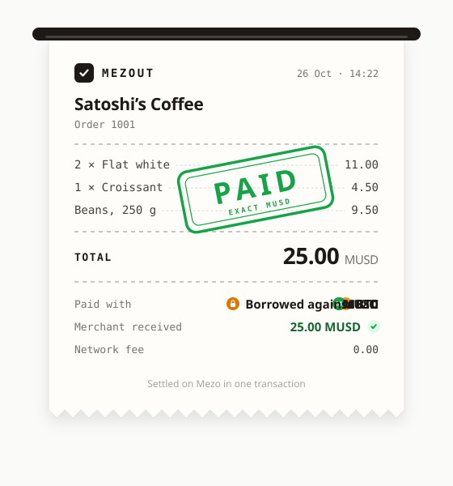</p>

## At a glance

| | |
| --- | --- |
| **4 ways to pay** | MUSD, BTC, MEZO, or MUSD borrowed against BTC inside the payment |
| **Exact settlement** | The merchant gets exactly the invoiced MUSD in the same transaction, or the whole payment reverts |
| **0 gas** | A relayer submits payments from EVM wallets and every passkey withdrawal |
| **0 wallets for merchants** | A passkey (Face ID, Touch ID, Windows Hello) owns an ERC-4337 smart account |
| **0 custody** | Funds go from the customer to the merchant. Mezout never holds funds or keys |
| **0 admin keys** | The router has no owner, no pause switch and no upgrade path |
| **166 tests** | 75 Foundry tests, including fork tests against live Mezo contracts, plus 77 app and 14 SDK tests |
| **Live proof** | Every payment path has been paid on Mezo testnet, with [transactions linked below](#proof-it-works-on-mezo-testnet) |

## Contents

- [The problem](#the-problem)
- [What Mezout does](#what-mezout-does)
- [Architecture](#architecture)
- [How a payment flows](#how-a-payment-flows)
- [Safety guarantees](#safety-guarantees)
- [Proof it works on Mezo testnet](#proof-it-works-on-mezo-testnet)
- [Hard problems we solved](#hard-problems-we-solved)
- [Tests](#tests)
- [Repository layout](#repository-layout)
- [Run it yourself](#run-it-yourself)
- [What's next](#whats-next)
- [License](#license)

## The problem

Bitcoin holders don't want to sell their BTC to spend it. Merchants won't install a wallet, store a seed phrase or buy a gas token to get paid. Most crypto checkouts fail one side or the other: the customer has to swap first, or the merchant ends up holding a volatile asset and managing keys.

| Who | Today | With Mezout |
| --- | --- | --- |
| Customer | Has to sell BTC, or find the exact token, and pay gas | Pays with what they hold, or borrows MUSD against BTC and keeps it, with no gas |
| Merchant | Needs a wallet, a seed phrase and gas, and gets a volatile asset | Signs up with a passkey and gets exact, stable MUSD |
| Developer | Has to build payment detection and reconciliation themselves | Calls one API, gets a signed webhook, or installs the WooCommerce plugin |

For Mezo, every checkout is new demand for MUSD and a reason to open and use a trove, which puts Bitcoin-backed money in front of ordinary shoppers.

## What Mezout does

### Customers pay any way, merchants get exact MUSD

The hosted checkout reads the customer's wallet and shows only the options they can actually use. Whatever they pick, `MezoutRouter` pays the merchant the invoiced amount in one transaction.

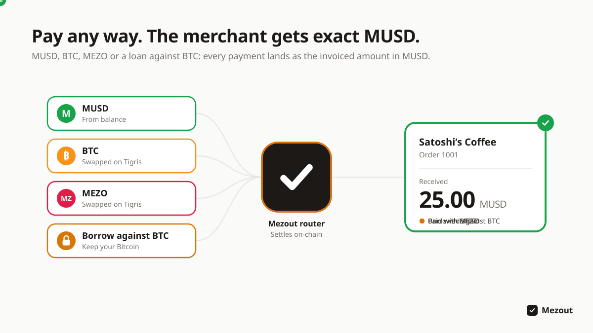

### Spend Bitcoin without selling it

A customer with a Mezo trove can borrow MUSD against their BTC inside the payment. The router checks the loan afterwards and reverts the whole payment if it would leave the trove under 160% collateral, so checkout can never push anyone toward liquidation.

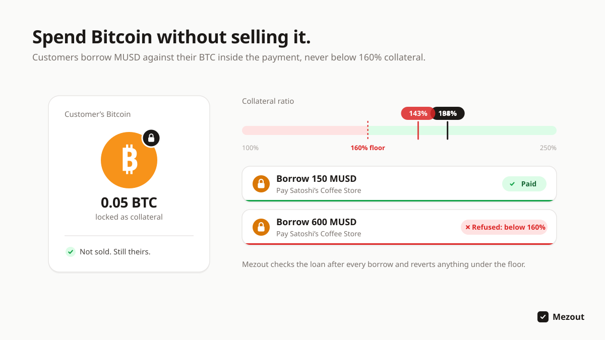

### Gasless by default

A customer paying from an EVM wallet signs one message, and Mezout's relayer submits the payment and pays the network fee. Merchants never pay gas either: payouts arrive directly and passkey withdrawals are sponsored. Customers using a Bitcoin wallet pay a small fee themselves for now (see [what the checkout offers](#what-the-checkout-offers)).

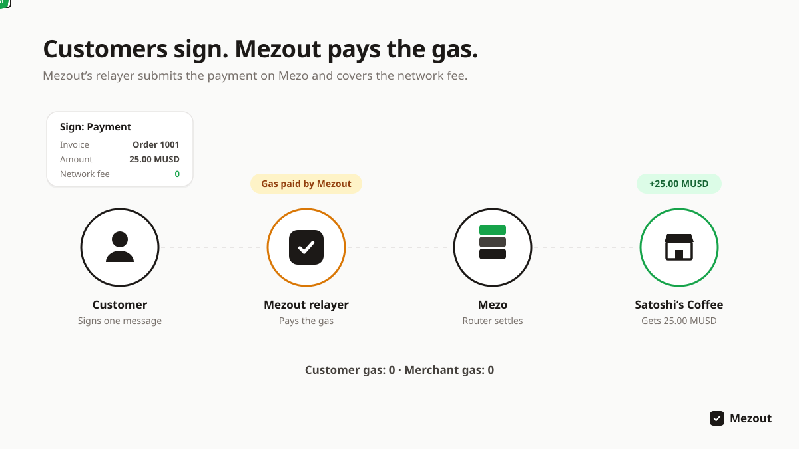

### A checkout customers already understand

Merchants share a link, show a QR code or redirect from their store. The customer connects a Mezo wallet through Mezo Passport, which supports EVM wallets and Bitcoin wallets (Xverse, Unisat, OKX), signs once, and sees the payment complete.

<p align="center">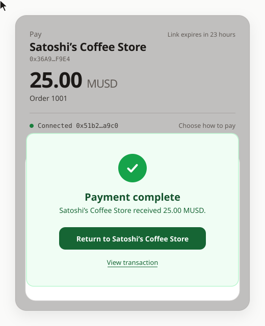</p>

### Merchants without a wallet

On the dashboard a merchant can choose **Create account with passkey**. The passkey owns a `MezoutAccount`, an OpenZeppelin ERC-4337 account with a WebAuthn signer, at an address derived from the passkey's public key. Payouts land there before the account even exists on-chain. Withdrawals are confirmed with the passkey and are gasless. Merchants who already have a Mezo wallet can sign in with it instead.

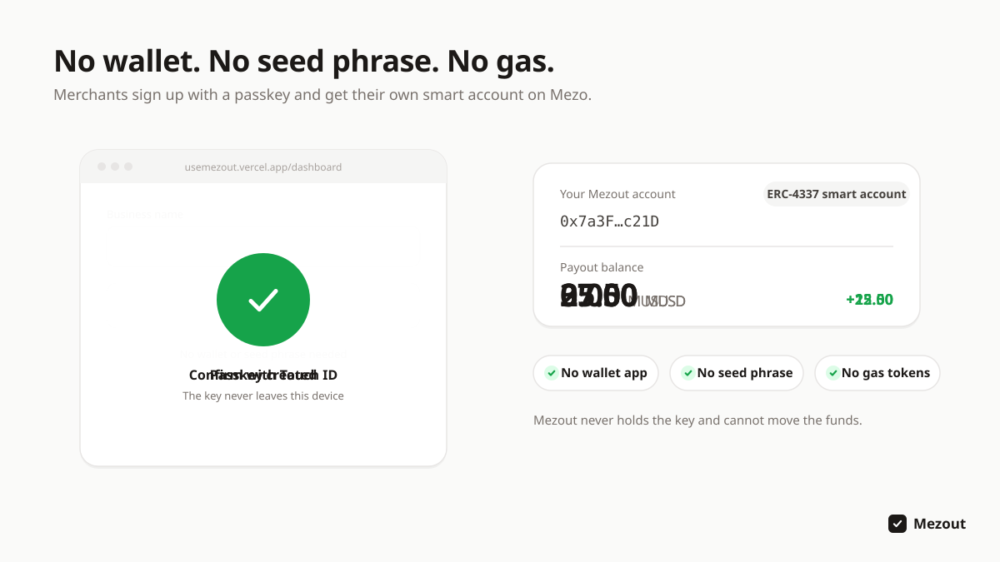

The dashboard has:

- **Overview:** the payout balance, a payment link and QR code generator, and recent payments
- **Payments:** every invoice with status, payment method and customer, CSV export, and refunds
- **Developers:** API keys, up to 3 webhook endpoints with their own signing secrets, test events, and a log of every delivery attempt
- **Account:** the business name customers see at checkout, the payout address, and gasless withdrawals

### Integrate in an afternoon

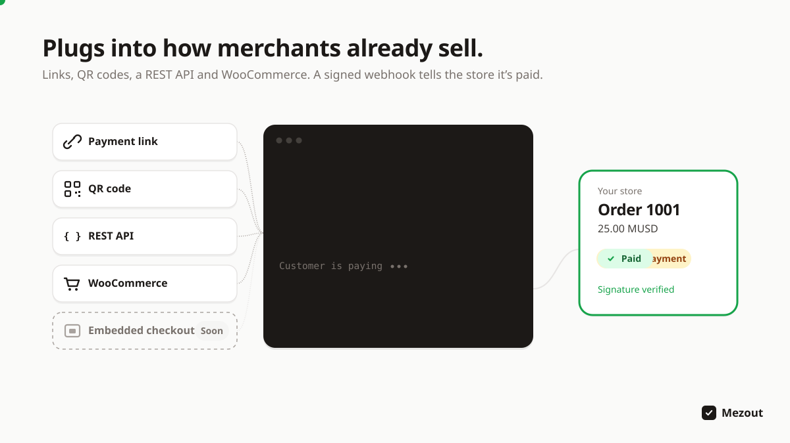

- **REST API** with API keys, idempotency keys and rate limits: create, list and retrieve invoices, request and cancel refunds, and manage webhook endpoints. [Full reference](docs/API.md), also published at [`/docs`](https://usemezout.vercel.app/docs).
- **Signed webhooks** (`invoice.paid`, `invoice.expired`, `refund.completed`, `refund.canceled`), signed with HMAC-SHA256 and retried with backoff for 24 hours. Verification code is provided for Node, PHP and Python, and [`examples/webhook-receiver`](examples/webhook-receiver) is a dependency-free receiver.
- **WooCommerce plugin** for the classic and block checkouts, with webhook-confirmed orders, link expiry and refunds from the order screen. See [`plugins/woocommerce`](plugins/woocommerce).

## Architecture

Mezout has three layers. The **contracts** enforce every money rule. The **app** signs invoices, relays payments and runs the merchant platform. **Integrations** connect stores. The app is never trusted with funds: it can only submit transactions that customers and merchants have signed.

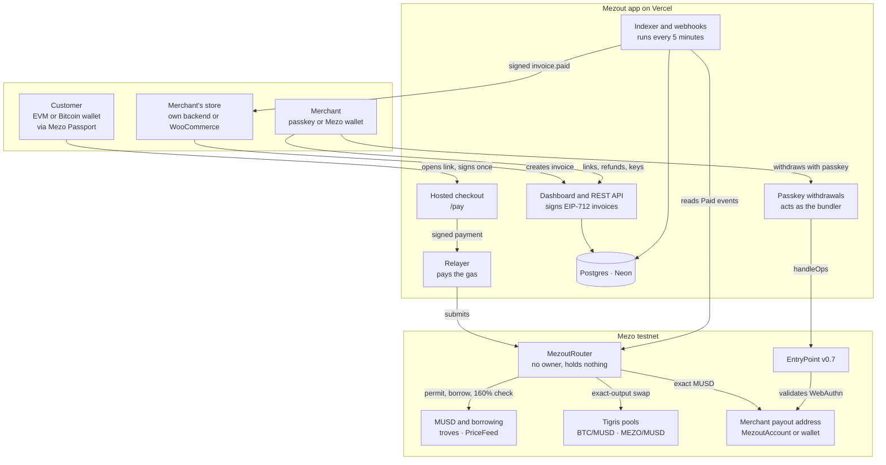

| Component | Code | What it does |
| --- | --- | --- |
| `MezoutRouter` | [`contracts/src/MezoutRouter.sol`](contracts/src/MezoutRouter.sol) | Verifies the signed invoice and the payer's signature, takes payment by one of four methods, pays the merchant exactly, emits `Paid`. Holds nothing between calls |
| `MezoutAccount` and factory | [`contracts/src/account`](contracts/src/account) | ERC-4337 account owned by a passkey. CREATE2 address from the passkey's public key, deployed on first use |
| SDK | [`packages/sdk`](packages/sdk) | EIP-712 typed data, payment-link encoding, chain config, ABIs, trove and borrow-limit reads |
| Hosted checkout | [`apps/web/src/components/Checkout.tsx`](apps/web/src/components/Checkout.tsx) | Reads balances, live Tigris quotes and the customer's trove, and shows only options that will succeed |
| Relayer | [`apps/web/src/app/api/relay/route.ts`](apps/web/src/app/api/relay/route.ts) | Simulates each payment, then submits it and pays the gas. Only calls Mezout's own routers |
| Indexer | [`apps/web/src/lib/server/indexer.ts`](apps/web/src/lib/server/indexer.ts) | Reads `Paid` events one block behind the head. This is the only way an invoice becomes paid |
| Webhooks | [`apps/web/src/lib/server/webhooks.ts`](apps/web/src/lib/server/webhooks.ts) | Signed events with retries and a delivery log, protected against requests to private networks |
| Merchant API | [`apps/web/src/app/v1`](apps/web/src/app/v1) | Invoices, refunds, webhook endpoints, with idempotency keys and rate limits |
| WooCommerce gateway | [`plugins/woocommerce`](plugins/woocommerce) | PHP plugin: creates invoices at checkout, completes orders from verified webhooks |

## How a payment flows

### End to end: from a store's order to fulfilment

A store creates an invoice, the customer pays on the hosted checkout, and the store learns about the payment from a signed webhook. Paid status comes from the chain, never from the customer's browser.

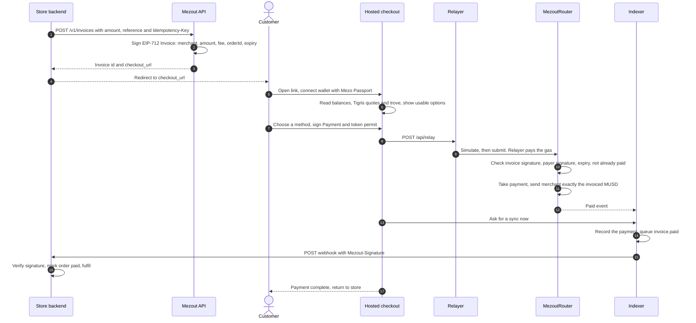

If the indexer's request from the checkout is missed, the scheduled run every 5 minutes catches the payment, and reading an unpaid invoice triggers a sync when the index is stale.

### What the checkout offers

The checkout only shows options that will succeed for this wallet, so a customer never signs something that reverts.

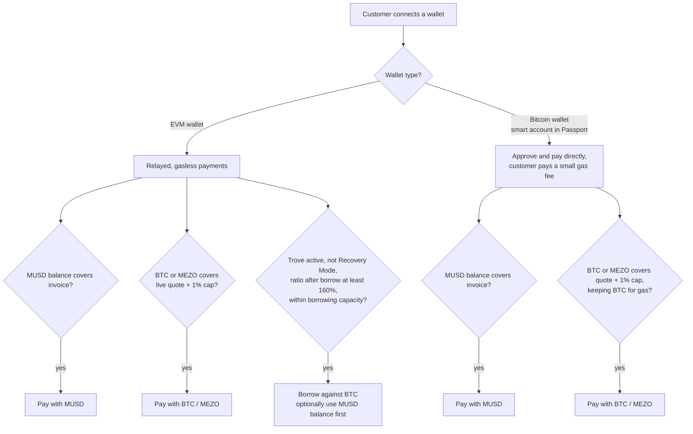

Bitcoin wallets in Mezo Passport act through smart accounts, which cannot sign the permits that MUSD and Mezo's borrowing contracts require, so those customers approve the router and call it themselves. Borrowing is offered only to EVM wallets for the same reason.

### Pay with BTC or MEZO: exact-output swap

Tigris has no exact-output swap, and the merchant must receive an exact amount. The router computes, at execution, the smallest input that buys exactly the invoiced MUSD, and takes only that.

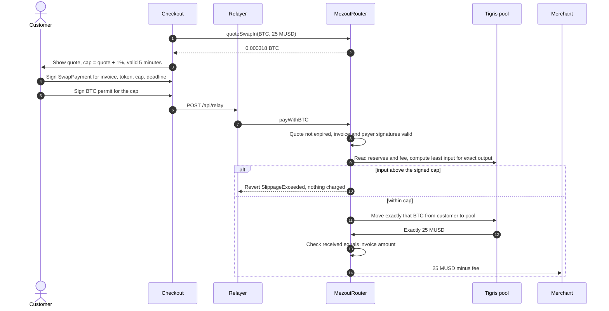

BTC is paid through Mezo's BTC ERC-20, which shares its balance with native BTC and supports permits, so a relayer can submit a BTC payment without the customer sending a transaction. Nothing is left in the router to refund.

### Borrow against BTC: guarded by a 160% floor

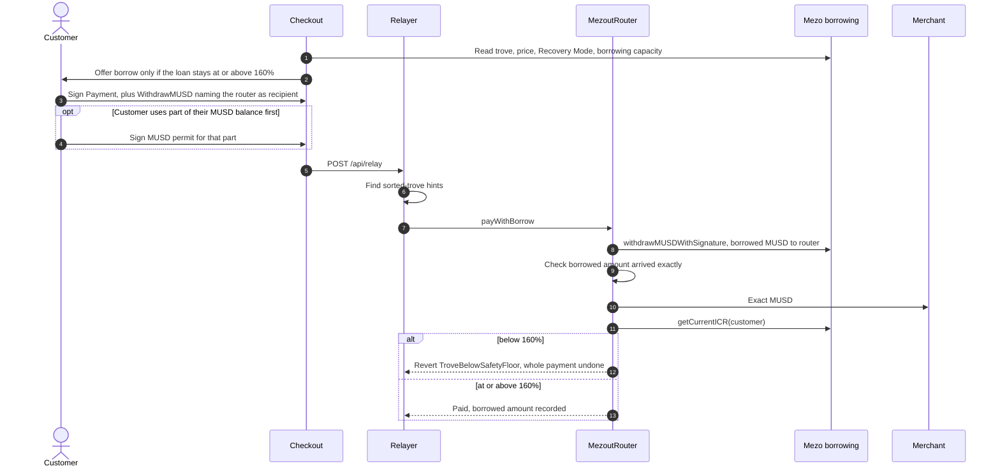

The customer keeps their BTC, the merchant is paid in full, and the loan stays well inside Mezo's own 110% liquidation threshold.

### Passkey merchant accounts and gasless withdrawals

There is no public ERC-4337 bundler on Mezo, so Mezout's relayer acts as one. It only ever submits a single MUSD transfer out of a registered account, and it cannot sign for the account.

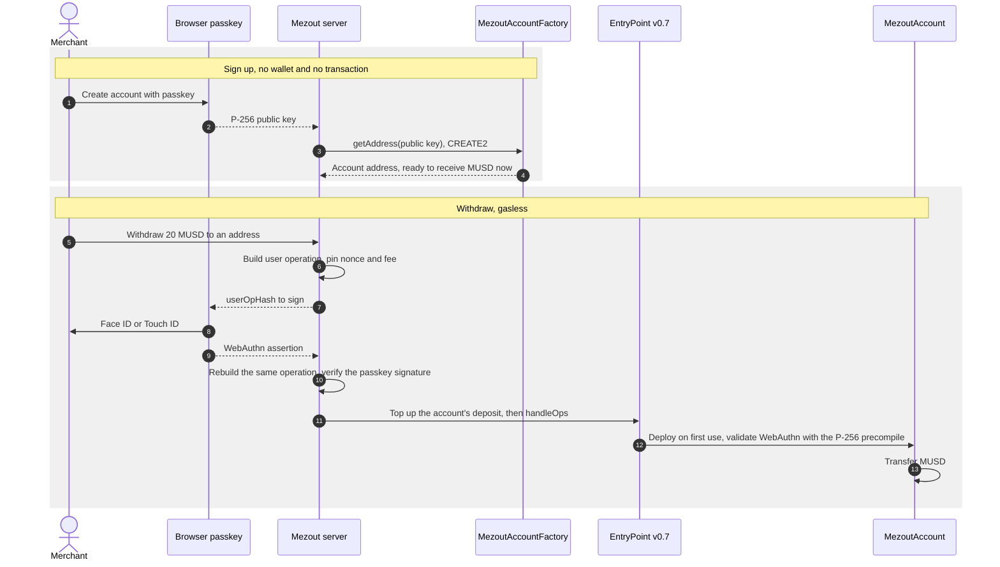

The account's signer is the passkey alone. Mezout never sees the private key and cannot move the funds.

### Invoice lifecycle

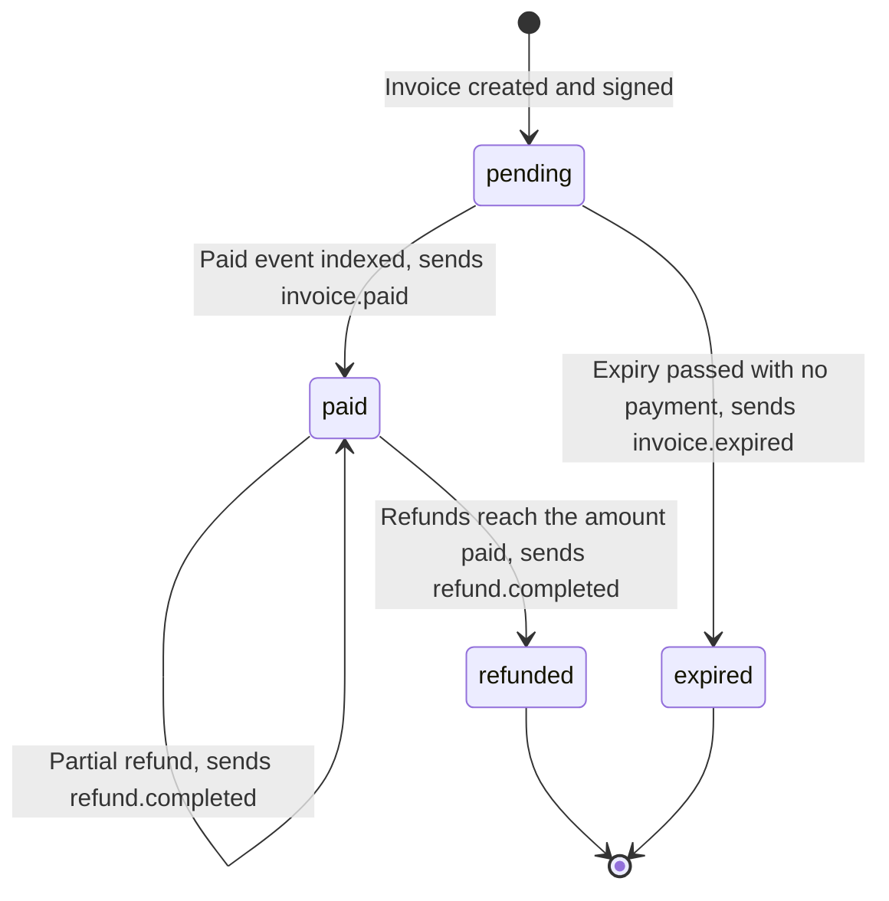

Mezout holds no funds, so a refund requested through the API stays pending until the merchant sends the MUSD from the dashboard. Mezout then checks the transaction on-chain before marking the refund completed, and refunds can never add up to more than the payment.

### WooCommerce order lifecycle

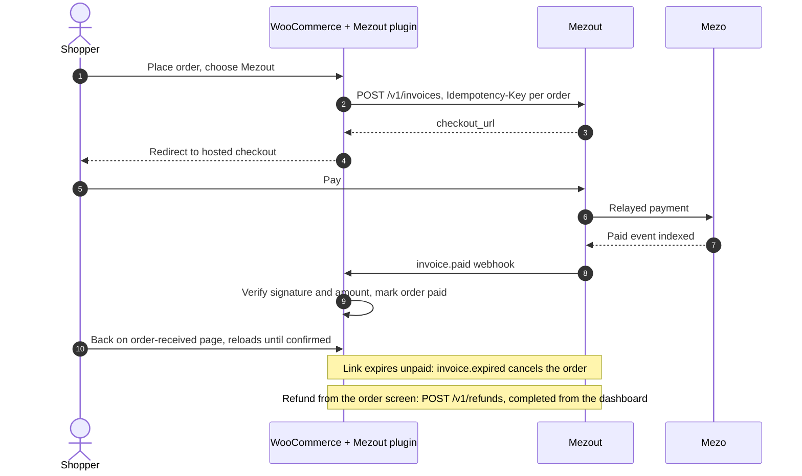

Saving the plugin settings checks the API key and registers the store's webhook endpoint automatically, so the merchant only pastes one key.

## Safety guarantees

| Guarantee | How it is enforced |
| --- | --- |
| The merchant gets the exact amount | The router transfers `amount - fee` to the merchant in the same transaction. Swaps check the MUSD received equals the invoice. Any shortfall reverts everything |
| One invoice, one payment | `paid[orderId]` is set before any transfer. Invoices are EIP-712 signed by Mezout's invoice signer and expire |
| A copied signature can't pay anything else | Relayed payments need the payer's own `Payment` or `SwapPayment` signature naming that exact invoice. A permit or borrow signature alone is not enough |
| Checkout can't push a customer toward liquidation | After a borrow, `getCurrentICR` must be at least 160%, or the whole payment reverts |
| Customers can't be overcharged on a swap | They sign a cap (quote + 1%) and a 5-minute deadline. The router takes only what the swap needs, never more than the cap |
| Non-custodial | Funds move from the customer to the merchant's address. The router keeps nothing between calls. Passkey accounts can only be moved by the passkey |
| No admin keys | No owner, no pause, no upgrades. All addresses are immutable constructor arguments |
| Paid means on-chain | Orders become paid only from indexed `Paid` events. Refunds are confirmed from their transaction receipts |
| Webhooks can be trusted | HMAC-SHA256 signature with a timestamp, per-endpoint secrets, retries for 24 hours, and endpoints restricted to public https addresses to prevent request forgery |
| The relayer can't be abused | It simulates first, only calls Mezout's routers, and is rate-limited per IP and per payer. The withdrawal relayer only submits single MUSD transfers out of registered accounts and caps the gas price |

The contracts are built from OpenZeppelin 5.6 parts and use transient-storage reentrancy guards. They have not had an external audit; one is planned before mainnet.

## Proof it works on Mezo testnet

### Deployment

| | |
| --- | --- |
| Live app | https://usemezout.vercel.app (dashboard: `/dashboard`, API reference: `/docs`, status: `/api/health`) |
| MezoutRouter | [`0xe132f9a1c8dbc31015C3Cf4eE8706c9031bFa431`](https://explorer.test.mezo.org/address/0xe132f9a1c8dbc31015C3Cf4eE8706c9031bFa431) (block 16,367,275): MUSD, borrow, MEZO and BTC |
| MezoutRouter v1 | [`0xAF79AB1cdB38c0C3944bB9440614B58871Ba6199`](https://explorer.test.mezo.org/address/0xAF79AB1cdB38c0C3944bB9440614B58871Ba6199) (block 16,341,328): MUSD and borrow only; still pays links made before 25 Oct |
| MezoutAccountFactory | [`0xeE85EE32488FF2D63eFe48159ddB59e6863cdF79`](https://explorer.test.mezo.org/address/0xeE85EE32488FF2D63eFe48159ddB59e6863cdF79) (block 16,343,339) |
| Tigris MUSD/MEZO pool | [`0x8eb88d745B0aFFF9D71AbC40d7F550Cded7bB342`](https://explorer.test.mezo.org/address/0x8eb88d745B0aFFF9D71AbC40d7F550Cded7bB342): created by Mezout with test tokens at 1 MUSD per MEZO (80 + 80) |
| EntryPoint v0.7 | `0x0000000071727De22E5E9d8BAf0edAc6f37da032` (canonical, already on Mezo) |
| Invoice signer | `0x289E256BF9Fb2ce0AF3186B015c371C5b3965943` |
| Fee recipient | `0x36A95C939Fa70F29421261C770160645Efa9F9E4` |
| Network | Mezo testnet, chain 31611 |
| Source verification | Sourcify, exact match: [MezoutRouter](https://repo.sourcify.dev/31611/0xe132f9a1c8dbc31015C3Cf4eE8706c9031bFa431), [v1](https://repo.sourcify.dev/31611/0xAF79AB1cdB38c0C3944bB9440614B58871Ba6199), [MezoutAccountFactory](https://repo.sourcify.dev/31611/0xeE85EE32488FF2D63eFe48159ddB59e6863cdF79). The Mezo explorer's verifier only supports EVM versions up to London, so it cannot verify Cancun builds |

### Reference transactions (24 Oct 2026)

All relayed by `0x7ECf…9a15`, so the customer paid no gas. Merchant `0x36A9…F9E4` unless noted.

| Path | Amount | Transaction | Gas |
| --- | --- | --- | --- |
| Pay with MUSD (permit) | 100 MUSD | [`0x4f97…cc48`](https://explorer.test.mezo.org/tx/0x4f9731b8b02102690edd793177e9bdc0a4b9456109f9c217d558c5fcd05bcc48) | 138,637 |
| Borrow against BTC | 150 MUSD, all borrowed; loan ratio 198% → 184% | [`0x6b8c…11ae`](https://explorer.test.mezo.org/tx/0x6b8c1ba62cddf247e14837380fbb8c154dc2b87e76d0c1b8afc867ec229711ae) | 513,935 |
| Pay with MUSD, invoice from production `POST /v1/invoices` | 12.5 MUSD to a new API merchant `0x9013…81C9` | [`0xf80d…2ade`](https://explorer.test.mezo.org/tx/0xf80ddf1aa4f9618eb00942606741d017941355fe568b314d87b11e9fd20e2ade) | 150,000 |

### Pay with BTC or MEZO (25 Oct 2026)

Relayed, so the customer paid no gas. Each time the customer was charged exactly the router's quote and the merchant received exactly the invoiced MUSD.

| Path | Amount | Transaction |
| --- | --- | --- |
| Pay with BTC from `scripts/pay-invoice.mjs` | 1 MUSD for 0.0000127 BTC | [`0x264e…a06b`](https://explorer.test.mezo.org/tx/0x264ee62d25265c7686153f0962ad96d8dc44272fc07e2ef297de5dab8819a06b) |
| Pay with BTC clicked through the checkout in Chrome | 1 MUSD | [`0x79d8…afff`](https://explorer.test.mezo.org/tx/0x79d84d8a7e4d523b08c757c4e0870107b3fe30d0fd9fdc7827b3e491c544afff) |
| Pay with MEZO clicked through the checkout in Chrome | 2 MUSD for 2.052 MEZO | [`0x3c7e…126a`](https://explorer.test.mezo.org/tx/0x3c7ea6fb940eb06f93c1d276129ab94a7dec6d625efa10422918722a0cb8126a) |

### Passkey merchant account (24 Oct 2026)

Driven through the dashboard in Chrome with a virtual passkey: account created without a wallet, paid 3 MUSD by a customer, API key created with the passkey, then two withdrawals. The account never held BTC.

| Step | Transaction |
| --- | --- |
| First withdrawal, 2 MUSD (also deploys the account through EntryPoint v0.7) | [`0x1a64…e478`](https://explorer.test.mezo.org/tx/0x1a6425e129bd79336a399f2016c75374d3ebfdc34d3815f1cb53c7ffe433e478) |
| Second withdrawal after signing out and back in with the passkey | [`0x0963…2f43`](https://explorer.test.mezo.org/tx/0x09633b328d2fc193d6f2c128004b053d67480a717e35d729eceead8939692f43) |

## Hard problems we solved

- **Mezo's signatures only work for regular wallets.** MUSD permits and `withdrawMUSDWithSignature` use plain ECDSA with no ERC-1271 support, so Bitcoin wallets in Passport (smart accounts) can't sign them. Gasless relayed payments serve EVM wallets, and a separate direct path lets smart accounts approve and pay themselves.
- **Tigris has no exact-output swap.** The router computes the least input that buys exactly the invoiced MUSD, fee included, from the pool's reserves at execution. The formula is fuzzed and fork-tested against the real BTC/MUSD pool: the quote passes and the quote minus 1 wei reverts.
- **No ERC-4337 bundler on Mezo.** The relayer calls `handleOps` itself and tops up each account's EntryPoint deposit. OpenZeppelin 5.6 defaults to EntryPoint v0.9, but Mezo has v0.7, so the account overrides it. Mezo's P-256 precompile makes passkey checks cheap.
- **Borrow limits go beyond the 160% ratio.** A trove also has a `maxBorrowingCapacity` fixed when it was opened, and Recovery Mode changes the rules, so checkout reads both before offering the borrow option.
- **No MUSD/MEZO liquidity on testnet.** We created and seeded our own Tigris pool.
- **The explorer can't verify Cancun builds.** The contracts need transient storage, so they are verified on Sourcify instead, with exact matches.

The full list, with what we learned, is in [`docs/SUBMISSION-ANSWERS.md`](docs/SUBMISSION-ANSWERS.md). What we checked on-chain before designing anything is in [`docs/M0-findings.md`](docs/M0-findings.md).

## Tests

| Suite | Count | Covers |
| --- | --- | --- |
| Contracts (Foundry) | 75 | Router unit and fuzz tests, swap quotes, passkey account vectors, typed-data vectors, and fork tests against live Mezo MUSD, troves, Tigris and EntryPoint |
| Web app (Vitest) | 77 | API, idempotency, indexer, passkeys, refunds, sessions, rate limits, webhooks, profiles |
| SDK (Vitest) | 14 | Typed data, accounts, chain config. 2 more run against the live testnet on request |
| WooCommerce (PHP) | | Webhook signature verification and amount handling, run in the WordPress container |

```
pnpm test                        # app and SDK
cd contracts && forge test -vv   # contracts, fork tests read Mezo testnet
```

## Repository layout

```
contracts/            Foundry: MezoutRouter, MezoutAccount and factory, tests, deploy scripts
apps/web/             Next.js 14: landing page, hosted checkout, dashboard, REST API, relayer, indexer
packages/sdk/         Typed data, payment links, chain config, ABIs, trove reads
plugins/woocommerce/  WooCommerce gateway (PHP) and its local WordPress setup
plugins/shopify/      Shopify app (next milestone)
examples/             Dependency-free webhook receiver
docs/                 API reference, development guide, findings, motion graphics
```

Built with Solidity 0.8.28, Foundry, OpenZeppelin 5.6, Next.js 14, React 18, TypeScript, viem, wagmi, Mezo Passport, Postgres (Neon) with Drizzle, Vercel and GitHub Actions.

## Run it yourself

The fastest way to try Mezout is the [live app](https://usemezout.vercel.app): sign up with a passkey on `/dashboard`, make a payment link, and pay it with a Mezo testnet wallet (test tokens from [faucet.test.mezo.org](https://faucet.test.mezo.org)).

To run it locally you need Node 20+, pnpm 9, Foundry and PostgreSQL 14+. In a terminal, inside the `Mezout` folder:

```
git submodule update --init --recursive
pnpm install
cp .env.example .env.local
pnpm --filter @mezout/web dev
```

[`docs/DEVELOPMENT.md`](docs/DEVELOPMENT.md) covers the database, tests, deploying the router and the app, seeding the pool, running the indexer and paying an invoice from a script. The WooCommerce plugin has its own guide in [`plugins/woocommerce`](plugins/woocommerce).

## What's next

- **Shopify app**, alongside the WooCommerce gateway
- **Embedded checkout**: a drop-in `mezout.js` script and React component that open the checkout in a modal inside the merchant's own site, with fulfilment still driven by the signed webhook
- **Mainnet readiness**: a passkey recovery key, an external security review, and deployment on Mezo mainnet
- **Deeper MEZO liquidity**: the current MUSD/MEZO pool is a small test pool
- **Gasless payments for Bitcoin-wallet accounts**, which pay their own gas today
- **Turning on the fee**: the signed invoice already carries a fee field, set to 0 during the buildathon, so no contract change is needed
- **More merchant tools**: payouts to exchanges, more ecommerce platforms, and in-person QR checkout

## License

[MIT](LICENSE), except the WooCommerce plugin in [`plugins/woocommerce/mezout-woocommerce`](plugins/woocommerce/mezout-woocommerce), which is GPL-2.0-or-later like WordPress itself.
