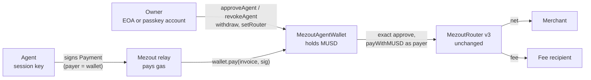

# Agent wallets with spending limits (Wave 4 design)

Status: unit-tested and deployed to Mezo testnet only: `MezoutAgentWalletFactory` [`0xA7316a0A276516620cCa0c6A9E19e0DE775d6A2c`](https://explorer.test.mezo.org/address/0xA7316a0A276516620cCa0c6A9E19e0DE775d6A2c) (router v3, block 16,797,922, verified on Sourcify). **Not independently reviewed; no live agent-wallet payment yet.** The router is unchanged.

An AI agent can already pay through `@mezout/mcp` with a raw private key, with caps that only the MCP process enforces. An agent wallet moves those caps on-chain: the owner keeps the money in a contract, and the agent holds only a session key that the contract limits.

## Contracts

`contracts/src/agent/MezoutAgentWallet.sol` (one per owner) and `MezoutAgentWalletFactory.sol` (CREATE2 by `(owner, salt)`, records `isWallet`).

| Who | Can do |
| --- | --- |
| Owner (`Ownable2Step`; renounce disabled) | `approveAgent(agent, maxPerPayment, maxPerDay, validUntil, merchants[])`, `revokeAgent`, `withdraw(token, to, amount)`, `setRouter` (must share the wallet's MUSD), transfer ownership in two steps |
| Agent session key | Nothing directly. Its signature authorizes one `pay` |
| Anyone (normally the relay) | `pay(invoice, invoiceSig, agent, agentSig)` |

`pay` checks, in order: the session exists and has not expired; `agentSig` is the agent's signature of `router.hashPayment(invoice, wallet)` (skipped only when the agent submits itself); the merchant is not the agent or the wallet, and is on the allow-list if one was set; the amount (fee included) is within `maxPerPayment` and today's remaining `maxPerDay`. It records the spend, approves the router for exactly `invoice.amount`, calls `payWithMUSD` with the wallet as payer and an empty permit, then requires the allowance back at zero and the balance down by exactly the amount. It is `nonReentrant`, as is the router.

**Per day = calendar UTC day** (`block.timestamp / 1 days`). A rolling 24-hour window needs a per-payment history (unbounded gas) or an approximation that is harder to reason about. A calendar day is O(1), predictable for the agent's client-side checks, and easy to audit. The cost: an agent can spend up to `maxPerDay` just before 00:00 UTC and again just after, so the worst case in any 24 hours is 2 × `maxPerDay` (pinned by `test_dayBoundary_worstCaseIsTwoDailyCapsIn24Hours`). Owners who need a strict 24-hour bound set `maxPerDay` to half of it.

**Re-approval** replaces limits and starts a fresh allow-list (keyed by a new session id), but today's recorded spending still counts.

## Trust model

- **The router stays the payment authority.** It verifies Mezout's invoice signature, the expiry and the one-time `orderId`, and pays the merchant exactly. The wallet adds limits on top; it cannot weaken anything the router checks.
- **The agent key can only pay real Mezout invoices.** There is no generic `execute`, no fallback, no `approve` or `transfer` an agent can reach. The router is called by the wallet itself, never by the agent. The wallet leaves no allowance between calls and does not implement ERC-1271, so the router cannot be called with the wallet as payer except through `pay`.
- **Signatures are the router's own EIP-712 `Payment`**, with the wallet as payer, under the router's domain (chain id and router address). A signature for one wallet does not work on another, one for the agent's own EOA does not work on the wallet, a relay cannot swap the invoice, and a router change voids pending signatures. Replay of the same invoice fails on the router's `paid[orderId]`.
- **Revocation is immediate**: a signature already in a relay's hands fails once the session is deleted. If the owner re-approves the same key later, an unpaid, unexpired invoice signed earlier could settle again under the new limits. Invoices expire (24 h by default), so this window is short; rotate keys rather than re-approving a compromised one.
- **A compromised session key** can, within its limits and until expiry or revocation, pay any merchant Mezout signs an invoice for, including a merchant account the attacker registers. Without an allow-list the per-payment and daily caps bound that loss; with an allow-list it is limited to the listed merchants. Paying the agent's own key or the wallet is refused outright.
- **The owner is trusted** with the funds: it can withdraw everything and change the router. A passkey owner (`MezoutAccount`) does this through its ERC-7821 `execute` as a sponsored user operation, so the owner needs no BTC either.
- **The relay** only pays gas. It submits only to wallets recorded by the configured factory whose `router()` is the current router and whose link names that router, and it simulates first, so a non-wallet contract cannot spend its gas.

## Gasless relayed payments

The agent signs one message and never needs BTC:

1. The agent decodes the payment link and signs `Payment(invoice, payer = wallet)` for the link's router (`signAgentWalletPayment` in `@mezout/sdk`). No permit: the wallet approves the router itself inside `pay`.
2. It posts `{ method: "AGENT_WALLET", token, wallet, agent, agentSig }` to `/api/relay`.
3. The relay checks the factory and router, simulates `wallet.pay`, and sends it. The router's `Paid` event names the wallet as payer, so the indexer, webhooks and `/v1/verify` work unchanged.

The relay branch is off until the network has a factory: `mezoutAgentWalletFactory` in `packages/sdk/src/addresses.ts` (the testnet entry of `networks.ts`), or `AGENT_WALLET_FACTORY_ADDRESS` on testnet. On mainnet only a verified entry in `networks.ts` counts, and an env value that differs from it stops the app at startup.

## MCP

`MEZOUT_AGENT_WALLET=<wallet>` turns it on; `MEZOUT_PAYER_PRIVATE_KEY` is then the session key. Without it, the raw-key mode is unchanged. Before signing, the payer reads the wallet's `router`, `sessions`, `remainingToday` and `canPayMerchant` and refuses with a clear reason anything the wallet would revert. The local per-payment and per-session caps still apply.

## Borrowing against the owner's BTC (not built)

Funding stays with the owner, never with the agent. A later `topUpByBorrow` on the wallet would take the owner's Mezo `WithdrawMUSD` signature (borrower = owner, recipient = wallet), call `BorrowerOperationsSignatures.withdrawMUSDWithSignature`, check that exactly that MUSD arrived, then require `troveManager.getCurrentICR(owner, price) >= 1.6e18`, the same 160% floor and check the router uses for `payWithBorrow`. A per-day top-up cap set by the owner would bound how much debt automation can add. Mezo's borrow signature is ECDSA, so this needs an EOA trove owner; passkey owners would sign the borrow as a user operation instead. The agent key never gets borrow authority.

## Attack tests

`contracts/test/unit/MezoutAgentWallet.t.sol` (37 tests, including one fuzz test): per-payment and daily limits, fee counted, the UTC midnight boundary and its 2× worst case, re-approval keeping today's spend, insufficient balance; allow-list, fresh allow-list on re-approval, agent paying itself, invoice paying the wallet, self-signed invoice; never-approved, forged, expired and revoked keys (with a signature in flight); replay of the same invoice, across wallets, of the EOA checkout signature, a tampered invoice, after a router change; agent calling owner functions, no generic call surface, the router called directly with the wallet as payer, a non-router `setRouter`; a malicious merchant contract that reenters `pay`, replays, withdraws and raises limits from a token hook; a passkey account as owner; the factory.

## Before a testnet deploy

- Owner sign-off on the open decisions below, and an independent review of the two contracts.
- ~~Deploy `MezoutAgentWalletFactory(routerV3)` and add its address to `@mezout/sdk`~~ (done 15 Nov 2026). Run one live payment from a test wallet (proof as in `docs/BORROW_V2_PROOF.md`).
- A dashboard screen to create a wallet and approve or revoke keys with the passkey; until then the owner calls the contract directly.
- Measure `pay` gas on testnet (at most about 250k in unit tests with a mock MUSD; the relay's floor is 450k).

## Open decisions

1. Calendar UTC day (built) or a rolling window.
2. Whether `setRouter` should be restricted to a Mezout-maintained list of routers.
3. A wallet-wide daily cap across all agents, in addition to per-agent caps.
4. Whether re-approving a previously revoked key should be blocked (key rotation enforced).
5. Whether to build the borrow top-up, and its daily cap.
