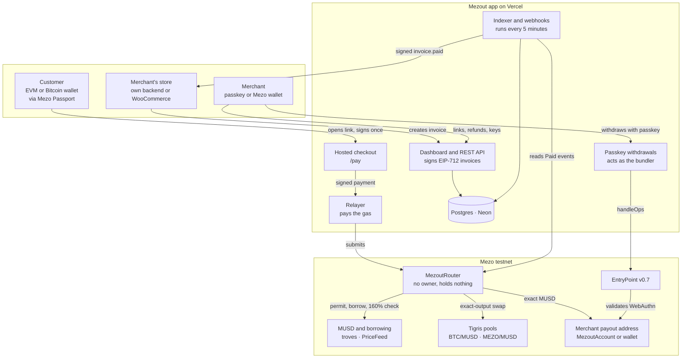
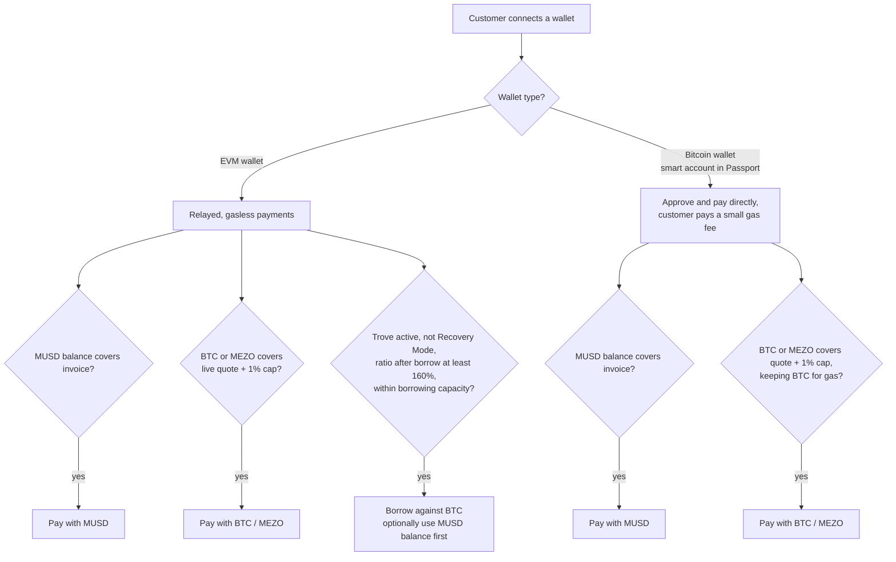
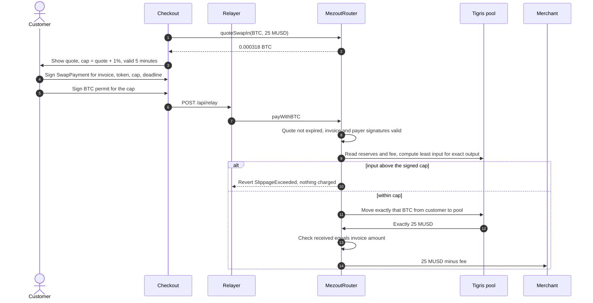
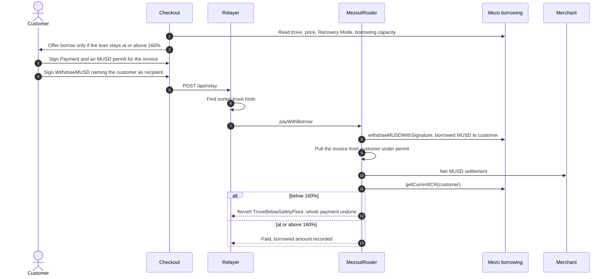
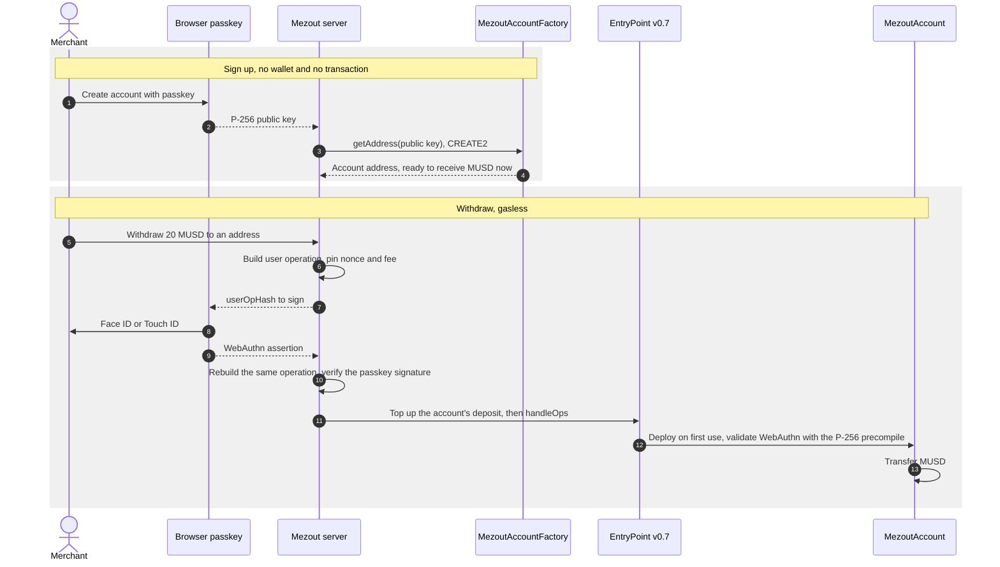
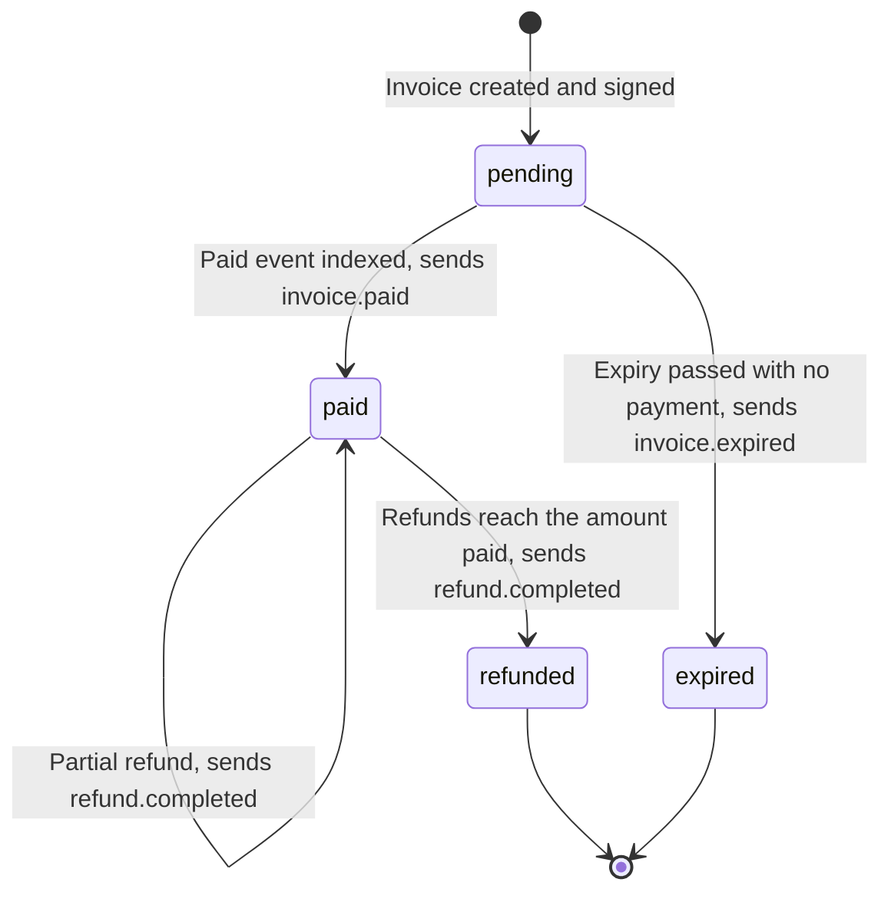
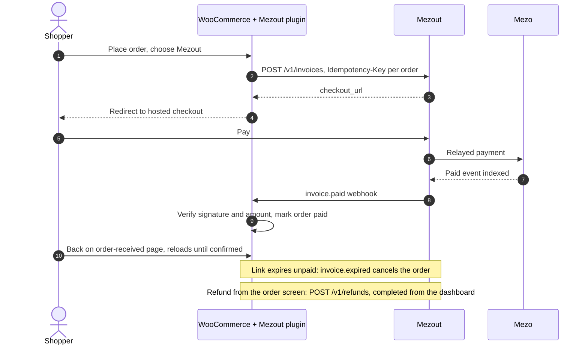

# How Mezout works

The diagrams behind the [README](../README.md): the system, each payment path, passkey accounts, and the invoice and WooCommerce lifecycles. For the API, see [`API.md`](API.md).

## Architecture

Mezout has three layers. The **contracts** enforce every money rule. The **app** signs invoices, relays payments and runs the merchant platform. **Integrations** connect stores. The app is never trusted with funds: it can only submit transactions that customers and merchants have signed.



## How a payment flows

### End to end: from a store's order to fulfilment

A store creates an invoice, the customer pays on the hosted checkout, and the store learns about the payment from a signed webhook. Paid status comes from the chain, never from the customer's browser.

```mermaid
sequenceDiagram
    autonumber
    participant S as Store backend
    participant A as Mezout API
    actor C as Customer
    participant K as Hosted checkout
    participant R as Relayer
    participant M as MezoutRouter
    participant I as Indexer

    S->>A: POST /v1/invoices with amount, reference and Idempotency-Key
    A->>A: Sign EIP-712 Invoice: merchant, amount, fee, orderId, expiry
    A-->>S: Invoice id and checkout_url
    S-->>C: Redirect to checkout_url
    C->>K: Open link, connect wallet with Mezo Passport
    K->>K: Read balances, Tigris quotes and trove, show usable options
    C->>K: Choose a method, sign Payment and token permit
    K->>R: POST /api/relay
    R->>M: Simulate, then submit. Relayer pays the gas
    M->>M: Check invoice signature, payer signature, expiry, not already paid
    M->>M: Take the invoiced amount; send merchant net MUSD and the signed fee to its recipient
    M-->>I: Paid event
    K->>I: Ask for a sync now
    I->>I: Record the payment, queue invoice.paid
    I->>S: POST webhook with Mezout-Signature
    S->>S: Verify signature, mark order paid, fulfil
    K-->>C: Payment complete, return to store
```

If the indexer's request from the checkout is missed, the scheduled run every 5 minutes catches the payment, and reading an unpaid invoice triggers a sync when the index is stale.

### What the checkout offers

The checkout only shows options that will succeed for this wallet, so a customer never signs something that reverts.



Bitcoin wallets in Mezo Passport act through smart accounts, which cannot sign the permits that MUSD and Mezo's borrowing contracts require, so those customers approve the router and call it themselves. Borrowing is offered only to EVM wallets for the same reason.

### Pay with BTC or MEZO: exact-output swap

Tigris has no exact-output swap, and the router must receive the full signed invoice amount before splitting merchant net settlement and the platform fee. It computes, at execution, the smallest input that buys exactly that MUSD amount, and takes only that.



BTC is paid through Mezo's BTC ERC-20, which shares its balance with native BTC and supports permits, so a relayer can submit a BTC payment without the customer sending a transaction. Nothing is left in the router to refund.

### Borrow against BTC: guarded by a 160% floor



The customer keeps their BTC, the merchant is paid in full, and the loan stays well inside Mezo's own 110% liquidation threshold.

### Passkey merchant accounts and gasless withdrawals

There is no public ERC-4337 bundler on Mezo, so Mezout's relayer acts as one. It only ever submits a single MUSD transfer out of a registered account, and it cannot sign for the account.



The account's signer is the passkey alone. Mezout never sees the private key and cannot move the funds.

### Invoice lifecycle



Mezout holds no funds, so a refund requested through the API stays pending until the merchant sends the MUSD from the dashboard. Mezout then checks the transaction on-chain before marking the refund completed, and refunds can never add up to more than the payment.

### WooCommerce order lifecycle



Saving the plugin settings checks the API key and registers the store's webhook endpoint automatically, so the merchant only pastes one key.

## Hard problems we solved

- **Mezo's signatures only work for regular wallets.** MUSD permits and `withdrawMUSDWithSignature` use plain ECDSA with no ERC-1271 support, so Bitcoin wallets in Passport (smart accounts) can't sign them. Gasless relayed payments serve EVM wallets, and a separate direct path lets smart accounts approve and pay themselves.
- **Tigris has no exact-output swap.** The router computes the least input that buys exactly the invoiced MUSD, fee included, from the pool's reserves at execution. The formula is fuzzed and fork-tested against the real BTC/MUSD pool: the quote passes and the quote minus 1 wei reverts.
- **No ERC-4337 bundler on Mezo.** The relayer calls `handleOps` itself and tops up each account's EntryPoint deposit. OpenZeppelin 5.6 defaults to EntryPoint v0.9, but Mezo has v0.7, so the account overrides it. Mezo's P-256 precompile makes passkey checks cheap.
- **Borrow limits go beyond the 160% ratio.** A trove also has a `maxBorrowingCapacity` fixed when it was opened, and Recovery Mode changes the rules, so checkout reads both before offering the borrow option.
- **No MUSD/MEZO liquidity on testnet.** We created and seeded our own Tigris pool.
- **The explorer can't verify Cancun builds.** The contracts need transient storage, so they are verified on Sourcify instead, with exact matches.

The full list, with what we learned, is in [`docs/SUBMISSION-ANSWERS.md`](SUBMISSION-ANSWERS.md). What we checked on-chain before designing anything is in [`docs/M0-findings.md`](M0-findings.md).

