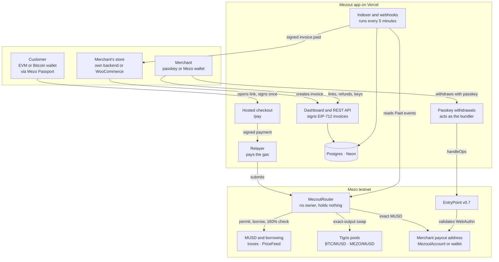
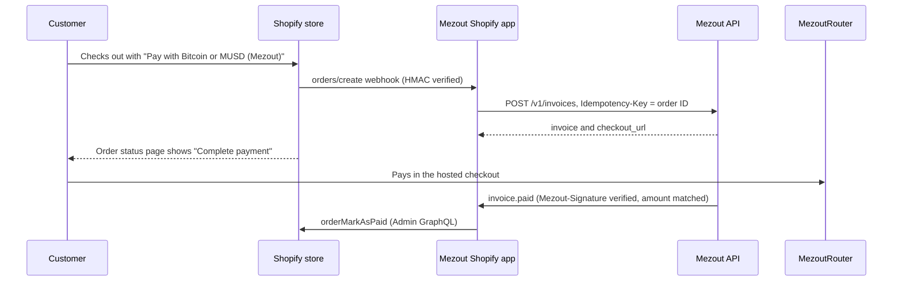
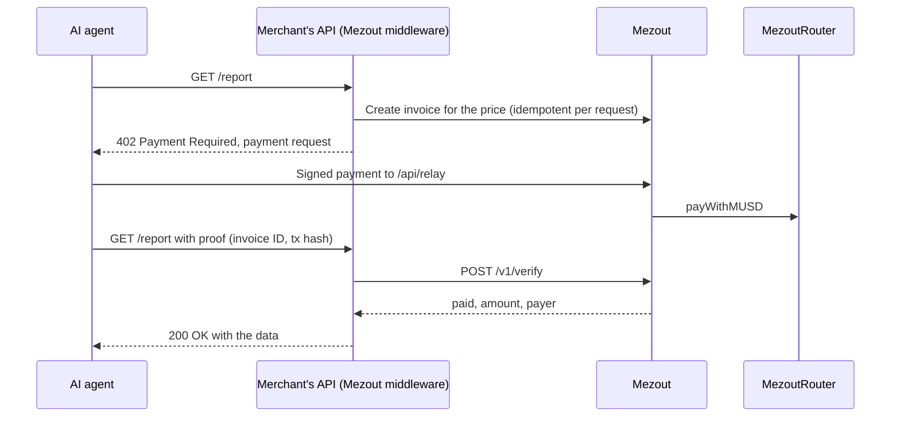
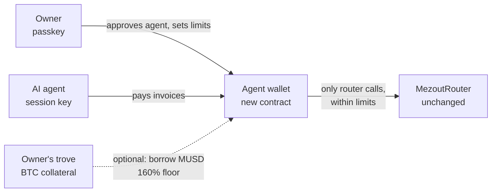

# Mezout progress report: Wave 1 delivered, Waves 2 and 3 planned

**Pay with Bitcoin. Get paid in MUSD.** Mezout is a merchant checkout on Mezo. Customers pay with MUSD, BTC or MEZO, or borrow MUSD against their BTC without selling it, and the merchant always receives the exact invoiced MUSD.

| | |
| --- | --- |
| Live app | https://usemezout.vercel.app |
| API reference | https://usemezout.vercel.app/docs |
| Code | https://github.com/Evangel90/Mezout |
| Network | Mezo testnet, chain 31611 |
| Track | Access & Distribution, Mezo Buildathon on AKINDO |

This report covers what was built and shipped in Wave 1 (24 to 26 Oct 2026), how it is put together, and what Waves 2 and 3 will deliver, with the architecture of each planned piece. The [README](../README.md) has the diagrams of every payment flow; this document is the progress record.

## Contents

- [Status](#status)
- [Wave 1: what we built](#wave-1-what-we-built)
  - [Architecture](#architecture)
  - [Smart contracts](#smart-contracts)
  - [Relayer and gasless payments](#relayer-and-gasless-payments)
  - [Hosted checkout](#hosted-checkout)
  - [Passkey merchant accounts](#passkey-merchant-accounts)
  - [Merchant platform: API, indexer, webhooks, refunds](#merchant-platform-api-indexer-webhooks-refunds)
  - [Dashboard](#dashboard)
  - [WooCommerce plugin](#woocommerce-plugin)
  - [Security model](#security-model)
  - [Proof on testnet](#proof-on-testnet)
  - [Tests](#tests)
  - [Hard problems solved](#hard-problems-solved)
- [Wave 2 plan](#wave-2-plan)
- [Wave 3 plan](#wave-3-plan)

## Status

| Milestone | What | Status |
| --- | --- | --- |
| M0 | Monorepo, every Mezo address verified on-chain, fork tests pinned to live contracts | Done, 24 Oct |
| M1 | Router with MUSD and borrow payments, hosted checkout, relayer, merchant API, passkey merchant accounts | Done, 24 Oct |
| M2 | Pay with BTC and MEZO through exact-output Tigris swaps, router v2 | Done, 25 Oct |
| M3 | Indexer, signed webhooks, refunds, dashboard sessions, orders and CSV export | Done, 25 Oct |
| M4 | WooCommerce gateway | Done, 26 Oct |
| Extra | Dashboard and checkout redesign, published API reference, API hardening, landing page with motion graphics | Done, 26 Oct |
| M5 | Shopify app | Wave 2 |
| M6 | Security self-review, demo video, Wave 2 submission | Wave 2 |
| Next | Embedded checkout, agent payments (MCP server, HTTP 402) | Wave 2 |
| Later | Mainnet, recovery keys, agent wallets, fee | Wave 3 |

The original plan put M2 to M4 in Wave 2. They were finished in Wave 1, so Wave 2 is free for distribution (Shopify, embedded checkout, AI agents) and hardening.

## Wave 1: what we built

### Architecture

Mezout has three layers, and the money rules live only in the bottom one.

1. **Contracts on Mezo** enforce every rule about money: the exact amount, one payment per invoice, the 160% borrow floor and the swap price cap. They have no owner, no pause and no upgrade path.
2. **The Mezout app** (Next.js 14 on Vercel, Postgres on Neon) signs invoices, relays signed payments, bundles passkey withdrawals, indexes payments and sends webhooks. It never holds funds and can only submit transactions customers and merchants have signed.
3. **Integrations** connect stores: a REST API, signed webhooks, a TypeScript SDK and a WooCommerce plugin.

**Monorepo** (pnpm workspaces):

| Package | Stack | Contents |
| --- | --- | --- |
| `contracts/` | Foundry, Solidity 0.8.28 (Cancun), OpenZeppelin 5.6 | `MezoutRouter`, `MezoutAccount`, `MezoutAccountFactory`, minimal Mezo and Tigris interfaces, unit, fuzz and fork tests, deploy scripts |
| `apps/web/` | Next.js 14, React 18, viem, wagmi, RainbowKit, Mezo Passport, Drizzle ORM, zod | Landing page, hosted checkout, dashboard, `/v1` REST API, relayer, withdrawal bundler, indexer, webhooks, `/docs` |
| `packages/sdk/` | TypeScript | EIP-712 typed data pinned to the router's hashes, payment-link encoding, chain config, ABIs, trove and borrow-limit reads, passkey account helpers |
| `plugins/woocommerce/` | PHP 8.1+ | WooCommerce payment gateway |
| `examples/webhook-receiver/` | Node, no dependencies | Reference receiver that verifies signatures and handles each event |

**Data model.** 14 Postgres tables over 6 migrations: `merchants`, `passkeys`, `sessions`, `api_keys`, `invoices`, `payments`, `refunds`, `chain_cursors`, `webhook_endpoints`, `webhook_events`, `webhook_deliveries`, `webhook_attempts`, `rate_limits` and `idempotency_keys`. Rate limits and idempotency records live in Postgres so every serverless instance shares them.

**Request paths.** Public API under `/v1` (API key), dashboard routes under `/api/dashboard` (12-hour HttpOnly session), and system routes: `/api/relay` (gasless payments), `/api/account/withdraw` (passkey withdrawals), `/api/sync` (index right after a payment), `/api/cron` (indexer and webhook retries, bearer secret) and `/api/health`.

### Smart contracts

All contracts are verified on Sourcify with exact matches.

| Contract | Address |
| --- | --- |
| MezoutRouter (v2: MUSD, borrow, BTC, MEZO) | [`0xe132f9a1c8dbc31015C3Cf4eE8706c9031bFa431`](https://explorer.test.mezo.org/address/0xe132f9a1c8dbc31015C3Cf4eE8706c9031bFa431) |
| MezoutRouter v1 (MUSD and borrow, still pays older links) | [`0xAF79AB1cdB38c0C3944bB9440614B58871Ba6199`](https://explorer.test.mezo.org/address/0xAF79AB1cdB38c0C3944bB9440614B58871Ba6199) |
| MezoutAccountFactory | [`0xeE85EE32488FF2D63eFe48159ddB59e6863cdF79`](https://explorer.test.mezo.org/address/0xeE85EE32488FF2D63eFe48159ddB59e6863cdF79) |
| Tigris MUSD/MEZO pool, created and seeded by Mezout | [`0x8eb88d745B0aFFF9D71AbC40d7F550Cded7bB342`](https://explorer.test.mezo.org/address/0x8eb88d745B0aFFF9D71AbC40d7F550Cded7bB342) |

#### MezoutRouter

**Invoices.** Mezout's invoice signer signs an EIP-712 `Invoice(address merchant, uint256 amount, uint256 fee, bytes32 orderId, uint64 expiry)`. The router checks the signature, the expiry and `paid[orderId]`, and sets `paid[orderId]` before moving any token, so an invoice can be paid once.

**Payer intent.** When a relayer submits the call, the payer must also have signed `Payment(Invoice invoice, address payer)` or, for swaps, `SwapPayment(Invoice invoice, address payer, address tokenIn, uint256 maxAmountIn, uint256 deadline)`. A permit or borrow signature taken from one payment can't be replayed to pay a different invoice. Signatures are checked with OpenZeppelin's `SignatureChecker`, so contract wallets (ERC-1271) are supported for this step.

**Four payment methods**, each in one transaction:

| Method | How it pays |
| --- | --- |
| `payWithMUSD` | Uses an MUSD permit (or an existing allowance) and transfers `amount - fee` to the merchant and `fee` to the fee recipient |
| `payWithBorrow` | Takes any part from the payer's MUSD, borrows the rest from the payer's trove with `withdrawMUSDWithSignature` straight to the router, checks the router received exactly that, pays the merchant, then reads `getCurrentICR` and reverts with `TroveBelowSafetyFloor` if the trove ended below 160% |
| `payWithBTC` | Exact-output swap on the Tigris BTC/MUSD pool, using Mezo's BTC ERC-20 (which shares its balance with native BTC and supports permit) |
| `payWithMEZO` | The same on the MUSD/MEZO pool |

**Exact-output swaps.** Tigris pools only swap exact input. The router computes the least input that buys exactly the invoiced MUSD from the pool's reserves at execution, including the pool fee and rounding (`amountIn = floor((ceil(rIn * out / (rOut - out)) - 1) * D / (D - fee)) + 1`). It pulls only that amount from the payer directly into the pool, swaps, and checks the MUSD received equals the invoice (`SwapMismatch` otherwise). The payer signed a cap (quote plus 1%) and a 5-minute deadline, enforced as `SlippageExceeded` and `QuoteExpired`. Nothing is left over to refund. A fuzz test and a fork test against the real BTC/MUSD pool show the quote passes and the quote minus 1 wei reverts.

**Events.** `Paid(orderId, merchant, payer, amount, fee, method, assetIn, amountIn, borrowed)` is the single source the indexer reads.

**Trust model.** No owner, no pause, no upgrades: every address (MUSD, BorrowerOperationsSignatures, TroveManager, PriceFeed, invoice signer, fee recipient, Tigris factory, BTC, MEZO) is an immutable constructor argument. `ReentrancyGuardTransient` protects every entry point. The router holds nothing between calls and rejects unexpected native BTC. The fee is part of the signed invoice and is 0 during the buildathon, so a fee can be turned on later without a contract change.

#### MezoutAccount and factory

`MezoutAccount` is an ERC-4337 smart account built only from OpenZeppelin 5.6 parts: `Account`, `SignerWebAuthn` (a P-256 passkey), and `ERC7821` batch execution. It is pinned to EntryPoint v0.7, the version deployed on Mezo (OpenZeppelin 5.6 defaults to v0.9). The factory derives the address with CREATE2 from the passkey's public key, so a merchant has a payout address the moment they sign up, and the account is deployed on its first withdrawal. Mezo's P-256 precompile keeps passkey verification cheap.

### Relayer and gasless payments

`/api/relay` accepts a payer's signed payment, rebuilds the call, simulates it, and only then submits it from Mezout's relayer wallet, paying the gas. It only calls Mezout's own routers (current and v1), validates every input, and is rate-limited per IP and per payer through the shared Postgres limiter, answering `429` with `Retry-After`. After a payment the checkout calls `/api/sync`, so the invoice turns paid within seconds.

Customers with a Bitcoin wallet in Passport use a smart account. Mezo's MUSD permit and `withdrawMUSDWithSignature` accept only plain ECDSA, so those customers approve and pay directly and pay their own gas; the borrow option is not offered to them.

### Hosted checkout

A payment link (`/pay/<link>`) carries the signed invoice. The checkout connects through Mezo Passport (EVM wallets and Bitcoin wallets), then reads the customer's MUSD, BTC and MEZO balances, live Tigris quotes and their trove, and shows only the options that will succeed:

- **MUSD** if the balance covers the invoice.
- **BTC or MEZO** with a live quote, the signed maximum on a second line, and "no network fee" when relayed.
- **Borrow** only with an active trove, no Recovery Mode, a ratio of at least 160% after borrowing, and the amount within the trove's `maxBorrowingCapacity`.

The checkout shows the business name, the payout address, the order reference and the time left on the link. After paying it confirms who received the payment and, if the invoice has a `success_url`, offers "Return to (business)".

### Passkey merchant accounts

Merchants can sign up without a wallet, seed phrase or gas token:

1. The browser creates a passkey. The server stores its public key and computes the account's CREATE2 address, which becomes the payout address.
2. Customers pay to that address straight away; the account does not need to be deployed yet.
3. To withdraw, the server returns a quote (nonce, gas price, whether the account is deployed). The passkey signs the user operation hash.
4. The server rebuilds the user operation from the quote, verifies the WebAuthn assertion, checks the gas price against the quote, tops up the account's EntryPoint deposit with `depositTo`, and calls `handleOps` itself, since Mezo has no public bundler. The first withdrawal also deploys the account.

The withdrawal path only submits single MUSD transfers out of registered accounts, and Mezout never holds a key that can move a merchant's funds.

### Merchant platform: API, indexer, webhooks, refunds

**REST API** (`/v1`, bearer API key, full reference at `/docs`):

- `POST /v1/invoices`, `GET /v1/invoices`, `GET /v1/invoices/:id`: create (with `success_url`), list with pagination, read with on-chain status, `amount_refunded` and `payment` (`fee` and `net`).
- `POST /v1/refunds`, `GET /v1/refunds/:id`, `POST /v1/refunds/:id/cancel`.
- `GET/POST /v1/webhook_endpoints`, `DELETE /v1/webhook_endpoints/:id`.
- `Idempotency-Key` on creates: the first response is kept 24 hours and replayed with `Idempotent-Replayed: true`; a reused key with a different body returns `422`, one still running `409`.
- Typed error codes, rate limits with `Retry-After`, and API keys listed by prefix and revocable.

**Invoice status** is derived, never set by hand: `pending`, then `paid` only from an indexed `Paid` event, `refunded` once refunds reach the amount, and `expired` one second after `expires_at`, matching the router, which still accepts payment during that second.

**Indexer** (`lib/server/indexer.ts`) reads `Paid` events from both routers in chunks of up to 10,000 blocks, one block behind the head, with a cursor per router in `chain_cursors` and backfill from v1's deploy block. It runs from `/api/cron` every 5 minutes through GitHub Actions, after every checkout payment through `/api/sync`, and when an unpaid invoice is read while the index is stale.

**Webhooks.** Events `invoice.paid`, `invoice.expired`, `refund.completed`, `refund.canceled` and `ping`. Each delivery is signed with HMAC-SHA256 over a timestamp and the body (`Mezout-Signature`) using a per-endpoint secret. Failed deliveries retry with backoff for 24 hours (the delay is capped at 6 hours), and every attempt is logged with its response. Endpoints must be public https: hosts are resolved when the endpoint is added and again on each delivery, private ranges are refused and redirects are not followed, which blocks server-side request forgery. Up to 3 endpoints per merchant. Verification examples in Node, PHP and Python, plus `examples/webhook-receiver`.

**Refunds.** A store or the dashboard requests a refund. The merchant sends MUSD from the payout address in the dashboard, and Mezout verifies the transfer from its transaction receipt before marking the refund completed and sending `refund.completed`. Declined or canceled requests send `refund.canceled`.

### Dashboard

One clear sign-in choice: a passkey account, or a Mezo wallet signing a message. Both create a 12-hour HttpOnly session. Four tabs:

- **Overview**: business name, payout address and balance, payment links with a full-size QR code and Copy and Open buttons.
- **Payments**: orders with status, method and amounts, CSV export, refunds (send or decline).
- **Developers**: API keys, webhook endpoints with secrets, a test ping, the delivery log with Retry now, and links to the docs.
- **Account**: business name, sign-in method and gasless MUSD withdrawals for passkey accounts.

### WooCommerce plugin

`plugins/woocommerce/mezout-woocommerce` (PHP 8.1+, WooCommerce 8.5+, tested on WordPress 7.1 and WooCommerce 11.2):

- Works on the classic and block checkouts and supports HPOS.
- Checkout creates a Mezout invoice with an idempotency key per order and sends the customer to the hosted checkout, with `success_url` back to the order.
- Only a verified `invoice.paid` with a matching amount marks the order paid. `invoice.expired` cancels unpaid orders.
- Refunds from the WooCommerce order screen become Mezout refund requests. `refund.completed` adds an order note, `refund.canceled` removes a declined refund, and refunds sent straight from the Mezout dashboard are recorded.
- Saving the settings checks the API key and registers the webhook endpoint automatically. Adds MUSD as a store currency.
- `pnpm zip` builds the installable zip; a local store runs through `@wordpress/env`.

### Security model

| Guarantee | How it is enforced |
| --- | --- |
| The merchant gets the exact amount | The router transfers `amount - fee` in the same transaction; swaps and borrows check the MUSD received; any shortfall reverts everything |
| One invoice, one payment | `paid[orderId]` is set before any transfer; invoices are signed and expire |
| A copied signature can't pay anything else | Relayed payments need the payer's `Payment` or `SwapPayment` signature naming that invoice |
| No push toward liquidation | `getCurrentICR` must be at least 160% after a borrow, or the payment reverts |
| No overcharging on swaps | Signed cap (quote plus 1%) and a 5-minute deadline; only the needed input is taken |
| Non-custodial, no admin keys | Funds go from customer to merchant; no owner, pause or upgrade; passkey accounts move only with the passkey |
| Paid means on-chain | Only indexed `Paid` events mark invoices paid; refunds are confirmed from receipts |
| Webhooks can be trusted | HMAC with timestamp, per-endpoint secrets, SSRF protection |
| The relayer can't be abused | Simulate first, Mezout routers only, rate limits per IP and payer, gas price caps on withdrawals |

No external audit yet; one is planned before mainnet (Wave 3).

### Proof on testnet

| Path | Transaction |
| --- | --- |
| Pay with MUSD, 100 MUSD, relayed | [`0x4f97…cc48`](https://explorer.test.mezo.org/tx/0x4f9731b8b02102690edd793177e9bdc0a4b9456109f9c217d558c5fcd05bcc48) |
| Borrow against BTC, 150 MUSD, ratio 198% to 184% | [`0x6b8c…11ae`](https://explorer.test.mezo.org/tx/0x6b8c1ba62cddf247e14837380fbb8c154dc2b87e76d0c1b8afc867ec229711ae) |
| Invoice from production `POST /v1/invoices`, 12.5 MUSD | [`0xf80d…2ade`](https://explorer.test.mezo.org/tx/0xf80ddf1aa4f9618eb00942606741d017941355fe568b314d87b11e9fd20e2ade) |
| Pay with BTC through the checkout | [`0x79d8…afff`](https://explorer.test.mezo.org/tx/0x79d84d8a7e4d523b08c757c4e0870107b3fe30d0fd9fdc7827b3e491c544afff) |
| Pay with MEZO through the checkout, 2 MUSD for 2.052 MEZO | [`0x3c7e…126a`](https://explorer.test.mezo.org/tx/0x3c7ea6fb940eb06f93c1d276129ab94a7dec6d625efa10422918722a0cb8126a) |
| First MEZO payment in production | [`0x7185…256ce`](https://explorer.test.mezo.org/tx/0x7185c981d0a3d13f182b607a4a8e322accdf1fa4b59d55cf7050c95b94b256ce) |
| Passkey withdrawal that also deployed the account | [`0x1a64…e478`](https://explorer.test.mezo.org/tx/0x1a6425e129bd79336a399f2016c75374d3ebfdc34d3815f1cb53c7ffe433e478) |
| Second passkey withdrawal after signing back in | [`0x0963…2f43`](https://explorer.test.mezo.org/tx/0x09633b328d2fc193d6f2c128004b053d67480a717e35d729eceead8939692f43) |

### Tests

| Suite | Count | Covers |
| --- | --- | --- |
| Contracts (Foundry) | 75 | Router unit and fuzz tests, swap quotes, passkey account vectors, typed-data vectors, and fork tests against live Mezo MUSD, troves, Tigris and EntryPoint |
| Web app (Vitest) | 77 | API, idempotency, indexer, passkeys, refunds, sessions, rate limits, webhooks, profiles |
| SDK (Vitest) | 14 | Typed data, accounts, chain config, plus 2 live testnet tests on request |
| WooCommerce (PHP) | | Webhook signature verification and amount handling |

### Hard problems solved

- **Mezo's signatures only work for regular wallets.** MUSD permits and `withdrawMUSDWithSignature` use plain ECDSA with no ERC-1271, so Bitcoin-wallet smart accounts get a separate direct path.
- **Tigris has no exact-output swap.** Solved with the reserve formula above, fuzzed and fork-tested to the wei.
- **No ERC-4337 bundler on Mezo.** Mezout calls `handleOps` itself and funds each account's EntryPoint deposit; the account is pinned to EntryPoint v0.7.
- **Borrow limits go beyond 160%.** Checkout also reads `maxBorrowingCapacity` and Recovery Mode.
- **No MUSD/MEZO liquidity on testnet.** We created and seeded the pool.
- **The explorer can't verify Cancun builds.** Verified on Sourcify instead.

## Wave 2 plan

Wave 2 runs to 15 Nov, with demo day on 23 Nov. Goal: put Mezout where merchants and AI agents already sell, and harden it for real money. Everything reuses the Wave 1 core: the router, signed invoices, the API, and signed webhooks as the only source of "paid".

### 1. Shopify app (M5)

Shopify reserves its payments-app API for approved payment partners, so Mezout ships as a public app that adds a manual payment method and finishes payment after checkout.

- **App**: OAuth install, session storage in the same Postgres, one Mezout API key per shop entered at setup and checked.
- **Checkout extension** on the thank-you and order status pages renders the "Complete payment" button with the invoice's `checkout_url`.
- **Orders**: `orders/create` creates the invoice (idempotent per order), `invoice.paid` with a matching amount marks it paid with `orderMarkAsPaid`, `invoice.expired` tags the order unpaid. Refunds created in Shopify become `POST /v1/refunds`, and `refund.completed` adds a note.
- **Done when**: it installs on a development store and an order is marked paid in Shopify after `invoice.paid`, with an install guide.

### 2. Embedded checkout

- `mezout.js`, a drop-in script, and a `<MezoutCheckout>` React component open the hosted checkout in a modal on the merchant's own site instead of redirecting.
- The checkout runs in an iframe of `/pay/<link>?embed=1`; a popup window is the fallback for wallets that don't work inside frames. Merchants list their allowed sites, enforced with a `frame-ancestors` content security policy.
- The frame reports progress to the page with `postMessage` (`mezout:paid`, `mezout:closed`) for the interface only. Orders are still fulfilled from the signed webhook, so a closed modal or a forged browser message can never mark an order paid.

### 3. Agent payments (demo-day showcase)

AI agents can already call the API. Wave 2 makes Mezout a native way for agents to pay and get paid.

**Mezout MCP server** (`packages/mcp`): tools `create_invoice`, `get_invoice`, `list_invoices`, `refund` and `pay_invoice`, over stdio and streamable HTTP, for Claude, Cursor and any MCP-capable agent. Merchant tools use a Mezout API key. `pay_invoice` signs the `Payment` and permit locally with the agent's own key and sends them to `/api/relay`, so keys never leave the agent's machine and the agent pays no gas.

**Pay per request over HTTP 402**: APIs charge an agent an exact MUSD price per call.

- `POST /v1/verify` checks the transaction receipt and its `Paid` event directly, so it doesn't wait for the indexer, and accepts each invoice once.
- Middleware for Express and Next.js: `mezout402({ price: "0.05" })` around a route.
- The payment-request format will follow the agent-payment standard current at build time (x402 or its successor) so agents that already speak it can pay.

### 4. Security and reliability (M6)

- **Router self-review**: signature domains and replay, permit front-running, swap math and rounding, the borrow floor and Recovery Mode, reentrancy, token callbacks and gas griefing through the relayer. Every finding fixed or documented, with new tests for each.
- **More fork tests**: Recovery Mode, a trove at exactly 160%, pool reserves moving between quote and execution, expired permits.
- **Reliable scheduling**: GitHub Actions' 5-minute schedule actually runs hours apart, which delays `invoice.expired` and webhook retries. An external scheduler will call the authenticated `/api/cron` every few minutes.
- **Monitoring**: relayer balance alerts, failed-delivery alerts, and a public status at `/api/health`.

### 5. Demo (M6)

A demo video under 3 minutes covering all four payment paths, passkey sign-up and withdrawal, the dashboard and both plugins, for demo day on 23 Nov.

## Wave 3 plan

Goal: go from a working testnet product to one real merchants can run on Mezo mainnet.

### 1. Mainnet readiness

- **External audit** of `MezoutRouter` and `MezoutAccount`, with the Wave 2 self-review as the starting point.
- **Recovery key for passkey accounts**: a second signer (a backup passkey or a recovery address) that can replace a lost passkey only after a delay the owner can cancel, so a lost device never means lost funds.
- **Key management**: the invoice signer and relayer keys move to a managed key service, with relayer balance limits and rotation runbooks.
- **Deployment**: contracts deployed and verified on Mezo mainnet with mainnet addresses as immutable constructor arguments; the app, API, SDK and plugins switch by network, and testnet stays as a developer sandbox with test API keys.

### 2. Agent wallets with spending limits

- The owner approves an agent's key with their passkey and sets limits per payment, per day and per merchant, plus an expiry.
- The wallet only allows calls to Mezout's routers within those limits, enforced on-chain; the owner can revoke the agent at any time.
- Optional funding by borrowing MUSD against the owner's BTC, so the agent spends without the owner selling Bitcoin, under the same 160% floor.
- A separate contract with its own review. The router's trust model and safety floor stay unchanged.

### 3. Better payments for every customer

- **Gasless payments for Bitcoin-wallet customers.** The router already accepts ERC-1271 payer signatures; the blocker is that MUSD and BTC permits need ECDSA. The plan is a one-time approval, after which every payment from that account is relayed and gasless.
- **Deeper MUSD/MEZO liquidity** than the current test pool, so larger MEZO payments get fair prices; the checkout will show the price impact.

### 4. Business model

Turn on the merchant fee. Signed invoices already carry a `fee` field (0 during the buildathon), and every payment already reports `fee` and `net` in the API and dashboard, so no contract change is needed.

### 5. More merchant tools

- Payouts to exchanges and scheduled sweeps from the payout address.
- More ecommerce platforms after WooCommerce and Shopify.
- In-person QR checkout for physical shops, using the same payment links.

### 6. First merchants

Onboard the first real merchants, starting with Bitcoin-friendly online shops, and let their feedback set the order of the roadmap.
