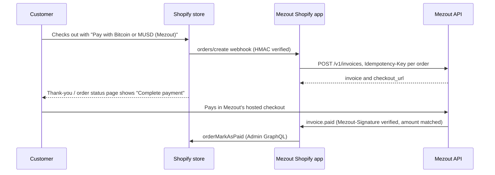

# Mezout for Shopify

A Shopify app for Mezout. Customers check out with a manual payment method ("Pay with Bitcoin or MUSD (Mezout)"), then pay on Mezo with Bitcoin, MUSD or MEZO, or by borrowing MUSD against their BTC. The merchant's Mezout payout address receives the order total in MUSD, less Mezout's signed platform fee.

Shopify reserves its payments-app API for approved payment partners, so the app does not appear as a card-style gateway. Instead it finishes payment after checkout:



- **Only a signed `invoice.paid` webhook whose amount matches the order marks it paid.** The amount must equal both the invoice the app created and what the order still owes in Shopify. A customer returning from checkout proves nothing.
- **One invoice per order.** The `Idempotency-Key` is `shopify-<shop>-order-<order id>`, and the app keeps a record per order, so a webhook Shopify delivers twice (or retries after a timeout) never creates a second invoice.
- **Expired links** tag the order `mezout-unpaid` and add a note. The order is not cancelled; the merchant decides.
- **Refunds** recorded in Shopify on a Mezout-paid order become refund requests in Mezout (`POST /v1/refunds`). The merchant sends them from the Mezout dashboard (Mezout never holds funds); `refund.completed` and `refund.canceled` add a note to the order.
- **Webhooks set themselves up.** Saving the API key checks it and registers `<app url>/webhooks/mezout?shop=<shop>` with Mezout, keeping the signing secret. `shopify app dev` gives the app a new tunnel URL on every run, so the app re-registers its endpoint when it starts, when the merchant opens it, and when an order arrives, deleting the endpoint for the old URL.
- **Currency.** Customers pay MUSD at one MUSD per US dollar. Shopify has no MUSD currency (WooCommerce's plugin adds one; Shopify cannot), so the store currency must be USD. Orders in any other currency, or presented to the customer in another currency, get no invoice: the app tags them `mezout-unsupported-currency` and adds a note saying why.

## How it works

| Step | Code |
| --- | --- |
| Settings page (embedded admin, Polaris): API key, payment method name, link lifetime. Saving checks the key with `GET /v1/invoices?limit=1` and registers the webhook endpoint. | `app/routes/app._index.tsx`, `app/mezout/connect.ts` |
| `orders/create`: if a payment gateway name matches the Mezout manual method, create an invoice for `total_outstanding` with `success_url` = the order status page, then save it (app database), set order metafields `mezout.invoice_id`, `mezout.checkout_url`, `mezout.status`, tag `mezout-awaiting-payment` and add a note. | `app/routes/webhooks.orders.create.tsx`, `app/mezout/orders.ts`, `app/mezout/gateway.ts` |
| Checkout UI extension on `purchase.thank-you.block.render` and `customer-account.order-status.block.render`: asks the app for the order's link (authenticated with Shopify's session token) and shows **Complete payment** while it is unpaid. | `extensions/mezout-payment-button`, `app/routes/api.payment-link.tsx` |
| `POST /webhooks/mezout?shop=…`: verifies `Mezout-Signature` (HMAC-SHA256 of `<t>.<raw body>`, timing-safe, 5-minute tolerance — the same scheme as the WooCommerce plugin and `examples/webhook-receiver`), skips event ids already handled, then handles `invoice.paid`, `invoice.expired`, `refund.completed`, `refund.canceled` and `ping`. Failures answer 500 so Mezout retries. | `app/routes/webhooks.mezout.tsx`, `app/mezout/mezout-webhook.ts`, `app/mezout/signature.ts` |
| `refunds/create`: sums the refund's successful refund transactions and requests that amount in Mezout (`Idempotency-Key` per Shopify refund). | `app/routes/webhooks.refunds.create.tsx`, `app/mezout/refunds.ts` |
| Uninstall deletes the shop's Mezout webhook endpoint and API key; `shop/redact` deletes its order records. | `app/routes/webhooks.app.uninstalled.tsx`, `app/routes/webhooks.compliance.tsx` |

Apps cannot write to Shopify's order timeline, so the app writes its history (invoice created, paid with transaction link, expired, refunds) as timestamped lines in the order's **Notes**.

The extension needs the app's URL, which changes on every `shopify app dev` run. The app writes it to the shop metafield `mezout.app_url` whenever it changes; the extension reads it from there. On the order status page the extension falls back to the order's own `mezout.checkout_url` metafield if the app cannot be reached.

Built from Shopify's official template, [`Shopify/shopify-app-template-react-router`](https://github.com/Shopify/shopify-app-template-react-router) (React Router 7, `@shopify/shopify-app-react-router`, Prisma session storage, Polaris web components; MIT, see `LICENSE.md`). The checkout extension uses Preact and `@shopify/ui-extensions` 2026.10.

## Install on a development store and test

What only the owner can do is marked **(owner)**: it needs a Shopify login in a browser. Nothing here costs money: Partner accounts and development stores are free, and Mezout runs on Mezo testnet.

You need Node 22.12 or newer, pnpm 9, a Mezout API key (dashboard → Developers tab at https://usemezout.vercel.app/dashboard), and a browser wallet with Mezo testnet funds to pay.

1. **(owner) Create a Shopify Partner account** at https://partners.shopify.com, then a **development store** (Stores → Add store → Create development store, "to test and build"). Keep the store currency **US dollar (USD)** (Settings → General → Store currency).

2. **Install dependencies.** In a terminal, in the `Mezout/plugins/shopify` folder:

   ```bash
   pnpm install
   ```

   This folder is its own pnpm workspace (with the checkout extension), separate from the monorepo's.

3. **(owner) Start the app.** In the same folder:

   ```bash
   pnpm dev
   ```

   The Shopify CLI opens a browser to log in to your Partner account, asks to **create a new app** (name it "Mezout") and which development store to use, and writes the new `client_id` into `shopify.app.toml`. It then starts a Cloudflare tunnel, the app, and the extension, and keeps running. Leave it open. Press `p` to open the app: Shopify asks you to install it on the store (OAuth) and opens the Mezout settings page.

   The app talks to production Mezout (testnet) at https://usemezout.vercel.app. To use another Mezout server, start it as `MEZOUT_API_BASE=https://… pnpm dev`. Mezout delivers webhooks to the tunnel's public https URL, so nothing else needs to be exposed.

4. **(owner) Allow what the app needs in the Partner Dashboard**, under Apps → Mezout → API access (wording may differ slightly; Shopify moves these settings between the Partner Dashboard and the Dev Dashboard):
   - **Protected customer data access** (Partner Dashboard → Apps → Mezout → **API access requests**, even for apps created in the Dev Dashboard): in **Step 1** select *Protected customer data* with the reason "Store management"; leave Name, Email, Phone and Address unticked. Step 2 (data protection details) is only for App Store review. A "not approved" banner refers to that review; development stores still get access. Shopify requires this for apps that subscribe to order webhooks. Development stores do not need Shopify's review. If `pnpm dev` prints an error about `orders/create` and protected customer data, this is the fix; restart `pnpm dev` afterwards.
   - **Allow network access in checkout and account UI extensions**: request it on the same page. Without it the **Complete payment** button cannot ask the app for the payment link, and Shopify will not publish the extension.

5. **Connect Mezout.** On the Mezout settings page in the Shopify admin, paste your API key (`mzk_test_…`) and click **Save**. It says "Connected" and shows the webhook URL (the tunnel URL plus `/webhooks/mezout?shop=…`). In the Mezout dashboard's Developers tab you can click **Send test event**: the `pnpm dev` terminal logs `POST /webhooks/mezout … 200`.

6. **Create the payment method.** In the Shopify admin: Settings → Payments → Manual payment methods → **Create custom payment method**. Name it `Pay with Bitcoin or MUSD (Mezout)` (or anything containing "Mezout", or the exact name set in the app). Under additional details, write something like: "After placing your order, click Complete payment on the next page to pay on Mezo with Bitcoin, MUSD or MEZO." Activate it.

7. **Add the Complete payment button.** First publish the extension once, in this folder: `pnpm exec shopify app deploy --allow-updates` (in testing, the checkout editor did not offer the in-development block; a released version shows up as an app block). Then Settings → Checkout → **Customize**. In the page selector choose **Thank you**, click Add app block, pick **Mezout payment button**, and save. Do the same for **Order status**. (While `pnpm dev` runs, the CLI's extension preview link also opens the editor.)

8. **Place an order.** Open the store (Online Store → Preferences shows the storefront password), add a product, check out, choose **Pay with Bitcoin or MUSD (Mezout)**, and place the order. Within a few seconds:
   - the thank-you page shows **Complete your payment** with a **Complete payment** button;
   - the order in the admin is **Payment pending**, tagged `mezout-awaiting-payment`, with a note naming the Mezout invoice and its link, and metafields `mezout.invoice_id` / `mezout.checkout_url`.

9. **Pay on testnet.** Click **Complete payment**, connect a Mezo testnet wallet in Mezout's checkout and pay. When the payment confirms on Mezo, Mezout sends `invoice.paid`: the order becomes **Paid**, tagged `mezout-paid`, with a note giving the method, payer and transaction link. Reload the thank-you or order status page: it says the payment was received.

10. **Optional: refunds and expiry.** Refund the order in Shopify (Refund → Refund manually): the order note says a refund was requested in Mezout; send it from the Mezout dashboard's Payments tab, and `refund.completed` adds the transaction to the note. To see expiry, set the link lifetime to 1 hour, place an order and don't pay: when `invoice.expired` arrives the order is tagged `mezout-unpaid`.

**Verified** on 11 Nov 2026 on a development store: storefront order #1006 got its invoice, the thank-you page showed **Complete payment**, the customer paid with BTC ([`0x7e93…c7f6`](https://explorer.test.mezo.org/tx/0x7e93416facb8b74abfaa508733465358fad9872e2774ee76a9c93bb0b369c7f6), 1 MUSD with a 0.01 MUSD fee), and the order became **Paid**, tagged `mezout-paid`.

### Troubleshooting

- **`pnpm dev` fails with "requires additional flags in non-interactive terminal environments"**: run it in a normal terminal. Without one, link the app first with `pnpm exec shopify app config link --client-id <Client ID>` (Dev Dashboard → Mezout → Settings → Credentials) and run `pnpm exec shopify app dev --store <store>.myshopify.com`.
- **`app config link` replaces `shopify.app.toml`** with the dashboard's bare copy, dropping the webhook subscriptions and `automatically_update_urls_on_dev`. Restore the file from git and set only `client_id` (don't commit it).
- **Orders get no invoice and the terminal shows no `Mezout: orders/create` line**: Shopify isn't delivering `orders/create`. The app subscribes each shop directly through the Admin API on startup and moves those subscriptions whenever the tunnel URL changes (the terminal logs `Shopify webhooks for … created …`); the app-level subscription in `shopify.app.toml` did not deliver on a dev preview. Every delivery is logged, including orders paid another way.
- **The app opens `example.com`**: Shopify is showing the released version (whose URL is the placeholder) instead of the dev preview. Restart `pnpm dev`, which turns the development store preview back on.

If an order does not get a payment link, its note and tags say why: `mezout-unsupported-currency`, `mezout-error` (no API key, or Mezout refused the request), or no Mezout tag at all when the payment method name did not match.

## Develop and test

In a terminal, in the `Mezout/plugins/shopify` folder:

```bash
pnpm test        # unit tests (Vitest), no Shopify or Mezout needed
pnpm typecheck   # app and extension
pnpm lint
pnpm build       # production build of the app
```

The unit tests replace the Mezout API with a fake behind `fetch` (`test/fakes.ts`, including `Idempotency-Key` replay) and Shopify's Admin GraphQL with a fake store. They cover signature verification, amount matching, gateway and currency matching, idempotent invoice creation (redelivery, retry after a 5xx, lost local record), the `invoice.paid` path and its refusals (wrong amount, changed order total, unpaid invoice, other store's invoice, duplicates, bad or old signatures), expiry, refund notes, refund requests, webhook endpoint registration across tunnel URL changes, and the payment-link endpoint's states.

`pnpm exec shopify app build` builds the app and the extension without logging in.

### Database

Sessions and Mezout data are in Prisma, SQLite by default (`prisma/dev.sqlite`, created by `pnpm dev` through `prisma migrate deploy`). The app's tables are `MezoutShop` (API key, webhook endpoint id, URL and signing secret per shop), `MezoutOrder` (one invoice per order) and `MezoutEvent` (handled Mezout event ids). They are not part of the main web app's Drizzle migrations.

To use Postgres, set `provider = "postgresql"` and `url = env("DATABASE_URL")` in `prisma/schema.prisma`, delete `prisma/migrations`, and run `pnpm exec prisma migrate dev --name init` against the new database. The API key and signing secret are stored as plain text, like Shopify's own session tokens in the template: keep the database private.

## Limits and follow-ups

- Not yet run against a real Shopify store: that needs the owner's Partner login (above). What is verified: unit tests, `tsc`, `eslint`, `react-router build`, `shopify app build` (app and extension), migrations on a fresh SQLite database, and HTTP smoke tests of `/webhooks/mezout` (signed ping, replay, bad signature, unknown shop) and `/api/payment-link` (CORS preflight, missing and invalid tokens, a valid HS256 session token) against the built server.
- Not deployed anywhere. Running it for real merchants needs a host with a persistent database (Postgres), `shopify app deploy` for the extension and configuration, and, for the Shopify App Store, Shopify's review.
- The **Order status** button uses `customer-account.order-status.block.render`, which works only with Shopify's new customer accounts (the default for new stores).
- An expired link is not renewed automatically. The merchant can create a new payment link in the Mezout dashboard and send it; the app does not track that link, so that payment does not mark the order paid automatically. **Planned (owner-approved future work): a "Send a new payment link" action** that creates a fresh invoice for the order under a new idempotency key, updates the Complete payment button, and keeps marking the order paid automatically.
- An order edited after its invoice was created gets `mezout-amount-mismatch` if paid, and is not marked paid; re-invoicing edited orders is a follow-up.
- Refunds sent straight from the Mezout dashboard add a note but are not recorded as Shopify refunds, and `refund.canceled` adds a note but does not undo a refund already recorded in Shopify (the WooCommerce plugin does both).
- `/api/payment-link` returns an order's checkout link to any checkout or customer-account session token from the same shop. A checkout link only lets someone pay that order's invoice to the merchant, so this exposes no funds.
